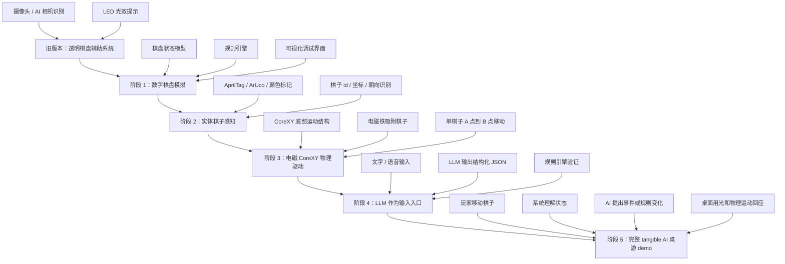
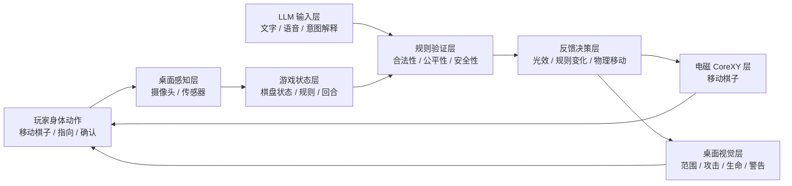
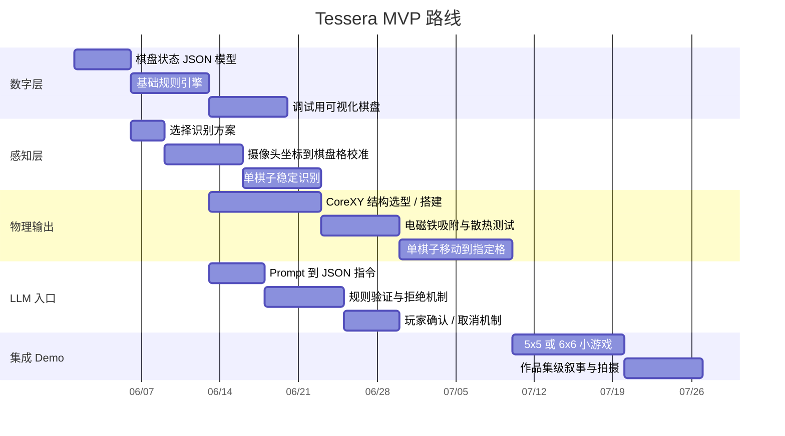

# Tessera 中文路径规划图

## 1. 项目一句话

Tessera 是一个结合实体棋子、桌面感知、电磁 CoreXY 驱动与 LLM 输入的 tangible media 桌面游戏系统。PC 端将使用专门为 Tessera / TabletopOS 设计的游戏编写与运行程序，不以兼容 Unity、Godot 等通用游戏引擎为目标。它研究的问题不是“AI 怎么替人玩游戏”，而是“AI 如何通过一个可触摸、可协商、可拒绝的物理界面进入游戏过程”。

## 2. 总体路径图



## 3. 交互闭环图



核心原则：

- 玩家和 LLM 都可以提出意图。
- 规则引擎负责裁决，不让 LLM 直接控制硬件。
- 桌面反馈必须回到可感知的物理世界，而不是只停留在屏幕上。

## 4. MVP 开发路线

当前最近的集成目标不是完整游戏或 LLM，而是先完成单个磁性棋子的整条交互链路：

```text
手进入桌面有效区域
  → PC 持续发送标定后的手部坐标
  → Pi 在 HUB75 的手下方绘制实时圆环光标
手在棋子上方做抓取手势
  → 选中棋子
  → 手移动时圆环继续跟随，并更新目标预览
  → 光标与目标预览都不直接驱动机构
  → 释放或确认手势提交一次 MOVE_TO
  → Pi 转发给 Arduino
  → CoreXY 移动棋子
  → Pi 根据 Arduino STATE 在 HUB75 上绘制蓝色拖影
  → 拖影按时间衰减并消失
```

当前灯板的红色通道存在局部异常，因此拖影严格保持红色分量为 0，光标也使用纯蓝或青色等 `R=0` 颜色。跟手光标与机构拖影是两个独立图层：前者来自 PC 手部坐标，后者只来自 Arduino `STATE` 的实际执行器位置。此阶段默认只有一个已知磁性棋子，不要求先解决多棋子身份识别。



## 5. 研究价值判断

这个项目是有意义的，而且比单纯“AI 桌游助手”更接近 tangible media 的方向。

它的价值不在于做一个更复杂的桌游，也不在于让 LLM 生成更多规则。真正有价值的地方是：它把 AI 的生成能力放进一个有物理阻力、有空间位置、有玩家身体参与的系统里。玩家不是面对一个聊天窗口，而是在桌面上通过棋子、光、移动、确认和拒绝来和 AI 协商。

这非常符合 tangible media / tangible interaction 的核心问题：

- 数字信息如何变成可触摸、可操纵的物理对象？
- 物理动作如何成为计算系统可以理解的输入？
- 当系统具有智能生成能力时，人如何保持 agency？
- AI 的建议如何被身体化、空间化，而不是只作为文本出现？

## 6. 需要警惕的风险

### 风险 1：技术很多，但论点不清

摄像头、LED、CoreXY、电磁铁、LLM 都很吸引人，但如果没有一个清晰研究问题，项目容易看起来像技术堆叠。

建议把核心问题固定为：

> 在 AI 介入规则生成时，实体桌面如何帮助玩家保持理解、控制和协商权？

### 风险 2：LLM 变成普通聊天入口

如果 LLM 只是“输入一句话，然后游戏发生变化”，它会比较像普通 AI 游戏 demo。

解决方式：

- LLM 输出必须被规则引擎验证。
- AI 生成的变化必须显示在桌面上。
- 重要变化必须允许玩家确认、拒绝或修改。

### 风险 3：电磁移动不稳定

一开始不要追求多个棋子自动移动。单个棋子稳定移动已经足够证明“数字世界反向影响物理桌面”。

建议第一版目标：

- 一个磁性棋子；
- 一个 CoreXY 电磁铁；
- 一个 5x5 棋盘；
- 能从一个格子移动到另一个格子；
- 移动前后有光效提示。

## 7. 推荐作品集表述

> Tessera explores AI-mediated tangible play: a tabletop system where physical pieces, computational rules, and generative AI negotiate through shared spatial interaction. Instead of replacing the player, AI becomes a visible and contestable participant in the game, expressed through light, movement, and rule changes on the board.

中文版本：

> Tessera 探索的是一种由 AI 介入的可触摸游戏系统。玩家的身体动作、游戏规则与生成式 AI 在同一张物理桌面上协商。AI 不再只是屏幕中的文本回应，而是通过光效、棋子移动和规则变化进入可被玩家理解、质疑和控制的游戏空间。

