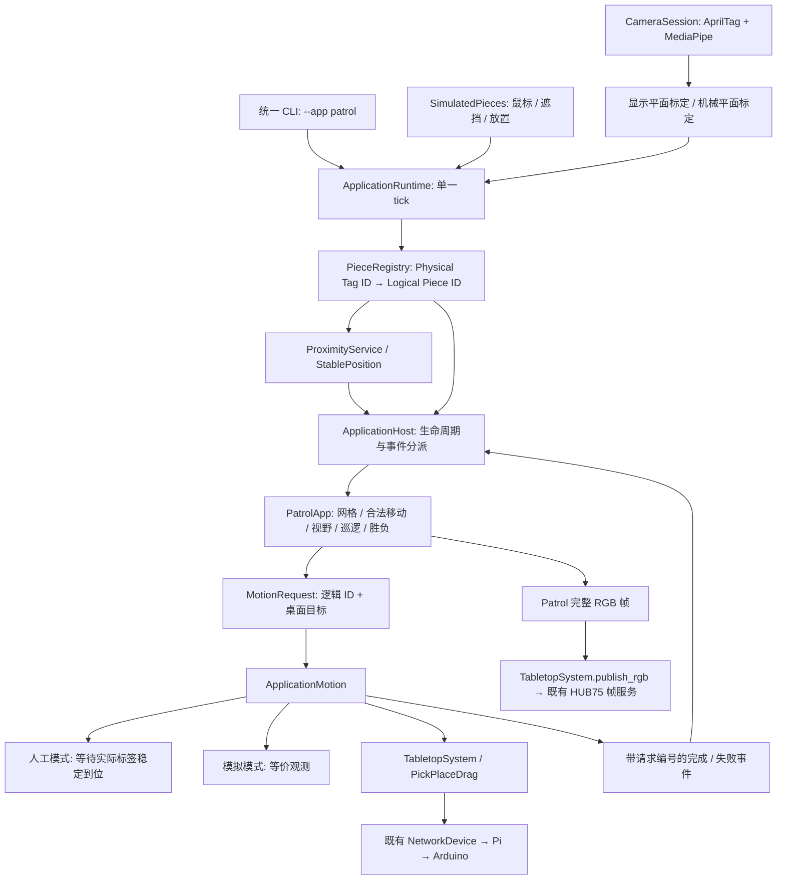

# Patrol V1：实现、运行与验收

2026-11-04 更新：已增加“一枚实体玩家＋虚拟守卫”，并恢复 RGB 完整输出。当前本地地图为 8×12 正方格。最新配置、部署与验收状态见 [虚拟守卫与 RGB 更新说明](PATROL_VIRTUAL_GUARD_ZH.md)；下文的双实体配置及 2026-11-03 测试记录是首版基线。

Patrol 是运行在 Tabletop OS 上的回合制潜行应用。软件实现和模拟闭环已验证；本次没有启动真实电机，也没有把软件测试结果当作摄像头、灯板或机构的实物验收。

## 原有架构检查

| 能力 | 仓库现状 | 本次处理 |
| --- | --- | --- |
| 主入口与更新 | `cli.py` 选择应用；`runtime.py` 和现有 Tk/OpenCV 窗口驱动 tick | 扩展同一入口，Patrol 使用调用方的单一 tick，没有后台游戏循环 |
| 应用 | 已有 `apps/single_piece.py`、`apps/gesture_drag.py`；有应用选择，没有通用生命周期管理 | 新增最小 `ApplicationHost`，提供加载、启动、暂停、停止、更新、事件分派、请求取出与释放 |
| AprilTag | `vision.AprilTagDetector` 使用 OpenCV AprilTag 字典；旧 `Observation.piece_id` 实际承载数字 Tag ID | 保留兼容类型，在平台注册表边界转换为字符串逻辑身份 |
| 手部 | `CameraSession` 复用 MediaPipe Tasks，返回指尖中点投影及捏合比 | Patrol 只使用投影位置，不要求捏合；未新增手部模型 |
| 标定 | `Calibration`、`project_between`，显示和机械平面独立标定 | 直接复用。新增的毫米平面只表示选中的发光桌面，不替代机械标定 |
| LED | `TabletopSystem` → `NetworkDevice` → TOSF/UDP → Pi HUB75 | 增加完整应用帧入口，保留原协议、会话与过期机制 |
| Pi / Arduino | TCP 控制、遥测、控制租约、故障和完成事件 | 不改协议和固件 |
| XY / 磁铁 | `PickPlaceDrag` 已有释放、寻找、吸合、拖动、释放和视觉确认；实物闭环仍待验收 | 完全复用，不从游戏直接发电机或舵机指令 |
| 安全 | 新鲜遥测、回零、限位、工作区、校准、超时、急停、看门狗 | 保留全部检查；Patrol 不支持 pickup-offset 绕过选项 |
| 配置、模拟、测试 | 严格 Runtime JSON、单棋子模拟及 unittest | 独立 Patrol JSON；新增等价输入适配器，游戏与交互规则共用 |
| 原本缺失 | Patrol、逻辑身份注册表、通用接近与放置状态机、应用生命周期 | 本次补齐 |

开发开始时工作区已有运动安全、诊断显示及路线文档的未提交改动；本次保留这些改动，没有清理或覆盖。

## 当前软件架构



`PatrolApp` 只接收逻辑 ID、稳定位置和运动结果，输出逻辑运动请求。代码不读取 AprilTag 数字、相机、串口、Arduino 或 Pi。网格完全属于 Patrol；平台交互继续使用连续坐标。

旧手势拖动和单棋子诊断入口保持可用。新应用可实现 Host 的生命周期、`observe`、`handle`、`motion_finished`、`update` 和 `take_requests` 接口；Host 切换时停止并关闭旧应用。平台的实体映射和接近服务不包含 Patrol 行动规则。

## 游戏与交互

默认地图为 8 列 × 6 行。坐标格式为 `(row, column)`。玩家每回合移动一个正交相邻格，障碍、越界及其他实体占据格不可进入。目标、撤离点、初始布局、巡逻路径和地图大小可配置。

玩家移动后先用守卫当前状态结算视野；没有失败且没有立即胜利时才生成守卫请求。守卫沿配置路径循环或往返，可配置每回合步数。每一步只生成一次请求；确认真实落点后才更新守卫的逻辑位置、朝向并再次结算。前方 90° 网格锥形视野支持距离限制和保守的障碍遮挡，射线接触障碍角也会挡住视线。危险格仍然是合法格；预览不保证守卫下一步行动后的安全。

游戏阶段包括 `SETUP`、`PLAYER_TURN`、`PLAYER_MOVE_VALIDATION`、`GUARD_TURN`、`GUARD_MOVING`、`RESOLVE`、`GAME_WON`、`GAME_LOST`、`ERROR_RECOVERY`。初始棋子全部稳定到达配置位置后才能开始。非法放置不改变已确认位置、不推进回合，必须稳定返回原格中心区域才能重新行动。

物理交互阶段独立为 `IDLE / PROXIMITY / MANIPULATING / RELEASE_PENDING / COMMITTED / CANCELLED`。仅接近、握住、原位放下均不消耗回合。目标在操作期间保持锁定；不会按最近位置把遮挡的玩家换认成守卫。稳定放置要求多个不同时间戳的新鲜样本、位置稳定、手离开后的确认间隔；缓存帧和单帧跳动无法提交行动。没有检测到手时，仍须等待跟踪宽限和放置确认；这属于二维启发式，不是三维抓握或触碰检测。

长时间识别丢失进入 `ERROR_RECOVERY`，保留已确认位置，不判为 `GAME_LOST`，不继续守卫运动。恢复实体位置后显式重开游戏。摄像头读取异常会停止更新与运动，需要修复输入后重新启动程序。

## AprilTag 配置与更换

配置位于 [`pc-runtime/config/patrol.json`](../pc-runtime/config/patrol.json)。例如只把 Player 从 5 改为 12：

```json
"pieces": {
  "player": {"tag_id": 12, "role": "player", "enabled": true},
  "guard": {"tag_id": 8, "role": "guard", "enabled": true}
}
```

保存后按窗口中的“重新加载配置 / 重开”或 `R`，也可以退出后重启。重新加载会重新校验文档、清除旧观测与交互缓存，并从 `SETUP` 开始新一局；将棋子放回配置起点。不会保留上一局回合。正在搬运或守卫运动时拒绝重新映射；可先停止再重开。新配置非法时，原映射保持不变。更换后旧 Tag 变成未注册标签，不会继续扮演原角色。

启动日志及窗口均显示逻辑 ID、角色和 Tag ID。`game.player_id / guard_id` 引用逻辑 ID，也可以使用 `infiltrator-2 / sentry-west` 等名称。`map.initial_positions` 必须覆盖所有启用实体。注册结构支持任意数量和角色；V1 规则仍只驱动一个主玩家和一个主守卫，其他已启用实体作为静态占位。必需的主玩家和主守卫必须启用。

Family 必须与 Runtime 的 `camera.april_tag_dictionary` 一致：

| Patrol `tag_family` | 检测器字典 | 合法 Tag ID |
| --- | --- | --- |
| `tag16h5` | `DICT_APRILTAG_16h5` | 0–29 |
| `tag25h9` | `DICT_APRILTAG_25h9` | 0–34 |
| `tag36h10` | `DICT_APRILTAG_36h10` | 0–2319 |
| `tag36h11`（当前默认） | `DICT_APRILTAG_36h11` | 0–586 |

这些范围已与本机实际 OpenCV 字典比对。字符串、布尔值、负数、小数、超出 Family 范围、重复分配（含禁用项）、重复 JSON 键及不兼容 Family 均被拒绝。未注册或禁用 Tag 会被忽略并记录；同帧出现多个相同已注册 Tag 会锁定为歧义并停止游戏，需替换标签后重启。

默认 Family 的打印工具已经存在，可从仓库根目录生成新标签：

```powershell
./pc-runtime/.venv/Scripts/python.exe pc-runtime/tools/make_apriltag.py --id 12 --output ./outputs/patrol-player-12.png
./pc-runtime/.venv/Scripts/python.exe pc-runtime/tools/make_apriltag.py --id 8 --output ./outputs/patrol-guard-8.png
```

该工具使用 `36h11`；选择其他 Family 时需使用对应 Family 的标签，不能混用打印图案。

## 实际运行命令

以下命令均从仓库根目录执行，Python 3.11+。仅模拟需要标准库及 Tk，不依赖 OpenCV、MediaPipe 或硬件。

```powershell
python -m venv pc-runtime/.venv
./pc-runtime/.venv/Scripts/python.exe -m pip install -e ./pc-runtime

# 鼠标交互模拟
./pc-runtime/.venv/Scripts/python.exe -m tabletop_os --app patrol --simulate

# 无窗口完整模拟，使用同一规则及交互状态机
./pc-runtime/.venv/Scripts/python.exe -m tabletop_os --app patrol --simulate --headless --demo --duration 60 --frame-output ./outputs/patrol-win.ppm

# 只检查配置、输出映射，不打开相机或连接设备
./pc-runtime/.venv/Scripts/python.exe -m tabletop_os --app patrol --simulate --patrol-config ./pc-runtime/config/patrol.json --check-config
```

模拟操作：移动鼠标靠近棋子，不点击也会显示预览；按住左键拖动模拟拿起和标签遮挡，松开模拟放下，再移开鼠标以确认操作。可以拖到非法格，随后必须拖回原位。侧栏可模拟标签长时间遮挡和守卫无响应。`Space` 停止，`R` 重新加载配置并重开。默认地图沿最底行向右，经过 `(5,4)` 取物，在 `(5,7)` 撤离。

自动演示使用相同纯游戏规则寻找胜利路径，再经模拟视觉输入逐步执行；不会通过直接改游戏位置实现胜利。默认结果为 `GAME_WON`、7 个玩家回合、6 个模拟守卫请求，并报告悬停、遮挡和取消验证结果。自定义地图找不到获胜路径或超过搜索上限时演示明确报错；交互模拟仍可使用。

### 摄像头准备与 Stage A：Camera Only

沿用现有视觉环境、模型和标定流程，详见 [PC 系统分层](PC_LAYERS_ZH.md) 及[硬件联调说明](HARDWARE_COMMISSIONING_ZH.md)。本机已有 `local-runtime.json`；其他机器应先从 `runtime.json` 建立自己的本地配置，填写相机、裁切、模型、Pi 地址及实际机械尺寸。

```powershell
./pc-runtime/.venv/Scripts/python.exe -m pip install -e './pc-runtime[vision]'
./pc-runtime/.venv/Scripts/python.exe pc-runtime/tools/download_hand_model.py

# 建立显示标定：按左上、右上、右下、左下选四角，S 保存，然后退出
./pc-runtime/.venv/Scripts/python.exe -m tabletop_os --app gesture-drag --config ./pc-runtime/config/local-runtime.json

# 只有摄像头及 PC 预览；不建立网络设备连接
./pc-runtime/.venv/Scripts/python.exe -m tabletop_os --app patrol --input camera --config ./pc-runtime/config/local-runtime.json --patrol-config ./pc-runtime/config/patrol.json
```

显示标定默认读取配置目录中的 `local-display-map.json`，可用 `--display-map` 指定。镜头校正格式目前沿用 `CameraSession` 的限制，只接受相同相机尺寸/裁切的平面标定。选择的显示平面在 Patrol 的 `map.width_mm / height_mm` 定义实际毫米宽高，当前示例是 320×480 mm。Runtime `board.width_mm / height_mm` 继续描述 298×466 mm 的机械工作区，两者不能互换。接近距离在显示桌面的毫米平面计算，运动目标再经公共相机平面转换到机械毫米，并接受现有边界检查。

### Stage B：Camera + LED，Manual Guard

在 Pi 正常运行既有 Bridge，`display.mode=frames`，并确认 Runtime 本地配置的网络地址后：

```powershell
./pc-runtime/.venv/Scripts/python.exe -m tabletop_os --app patrol --input camera --config ./pc-runtime/config/local-runtime.json --patrol-config ./pc-runtime/config/patrol.json --led
```

保持真实运动关闭。每次玩家行动后目标格高亮，由用户手动移动守卫；新标签位置稳定且手移开后才继续。窗口明确显示 `MANUAL`，不会报告自动运动成功。配置的 `motion_timeout_s` 同样限制人工等待。未传 `--led` 的 Stage A 也使用人工守卫。

2026-11-04 用户确认红色硬件故障已修复，Patrol 现在统一输出红色守卫格和橙色危险预览，Pi `frames` 输出保留 RGB。旧 Pi Bridge 仍会把红色清零，需更新树莓派程序才能解除；仅重启 Python 不能解除树莓派端的屏蔽。目标和撤离标记继续保留在视觉叠加层上。

### Stage C：显式 Hardware Motion

只有 A/B 阶段和原有运动安全联调通过后才使用。需要显示标定、机械标定来自同一相机机位和裁切；配置中的舵机角度必须在本机确认安全。

```powershell
./pc-runtime/.venv/Scripts/python.exe pc-runtime/tools/calibrate_camera.py --config ./pc-runtime/config/local-runtime.json
./pc-runtime/.venv/Scripts/python.exe -m tabletop_os --app patrol --input camera --config ./pc-runtime/config/local-runtime.json --patrol-config ./pc-runtime/config/patrol.json --hardware-motion --speed 2 --max-drag-mm 100
```

默认不自动回零、不自动启用运动。显式硬件模式下，若未回零可按 `H`：先停止游戏，调用既有释放磁铁后回零的安全流程；等待状态回到 `IDLE` 后按 `R` 重开。`Space` 停止，不重放失败请求。速度为实际毫米/秒；示例 2 mm/s 需按实测调整。最大拖动距离、机械边界、遥测新鲜度、校准、回零、控制租约、故障、限位、超时和下位机看门狗全部保留。完成事件还须通过现有视觉验证及应用层稳定落点验证；仅收到电机完成消息不能推进回合。路径上的格子虽可通行，实体尺寸、磁力和障碍实物间距仍需实测。

## 配置参数

`proximity` 内含进入/退出距离、进入停留时间、手部短暂丢失宽限、Tag 丢失宽限、稳定时间、抖动半径、最少独立样本、观测有效时间及放手确认时间。`map.center_tolerance` 和 `boundary_hysteresis` 是格宽/格高的比例，分别约束中心有效区域及格边界的不确定带。边界或中心容差之外的稳定落点按非法位置处理，不自动纠正玩家棋子。

默认距离和时间只作为调试起点，应按棋子、摄像头、遮挡时长和标定实测调整。正常搬运会遮挡较久时应增加 `tag_loss_grace_s`；过期后必须人工恢复。配置的稳定半径必须小于格中心有效区域。改变地图大小或机械尺寸后，仍不能绕过真实工作区检查。

## 自动化测试和实际验证

```powershell
./pc-runtime/.venv/Scripts/python.exe -m unittest discover -s pc-runtime/tests -q
```

Windows 受限运行环境如不能写系统临时目录，可把 `TEMP` 和 `TMP` 指向仓库内已存在的 `tmp`。设备通信测试只使用本机回环的假 Bridge，不使用真实机构。

2026-11-03 软件验收：

- 完整 PC 测试 **198 项全部通过，无跳过**，耗时 20.551 秒；其中原有 136 项，本次新增 62 项。新增测试覆盖游戏规则、交互、注册配置、人工守卫、生命周期和运动适配器。
- 实际 OpenCV 在合成标签图像中检测 5、12、33，注册表把 12 映射为玩家、33 映射为守卫，忽略旧 ID 5。各 Family 范围与实际 OpenCV 字典比对通过。
- 共用 Runtime 的完整无窗口模拟：预览、原位遮挡、取消、取物、巡逻与撤离通过，默认 7 回合获胜。
- 原生 Tk 窗口实际操作：无点击悬停显示范围；拖放后保持等待；移开鼠标后只提交一次并移动守卫。窗口能正常关闭。
- 重复编号、非法编号、Family 不匹配、未知标签、旧标签失效、不同逻辑 ID、短/长遮挡、缓存帧、抖动、非法放置恢复、手未离开、危险格、障碍视野、运动超时/失败、断连、停止/重开/释放及关闭运动时零运动请求都有软件测试。

需要实物验证的项目：真实摄像头帧率与手部接近阈值、实际标签更换和遮挡表现、LED 与格子对齐及色彩可读性、手动守卫到位确认、舵机/磁铁吸附与释放、真实运动完成/失败/急停、全部安全间距。Stage C 尚未验收。本次没有修改 Pi/Arduino，也没有进行实机运动。

已知限制：单摄像头二维投影会受手离桌高度影响；MediaPipe 当前只跟踪一只手，未提供稳定跨帧手部 ID；重开不保留局面；长时间丢失要求重开；摄像头读取失败需重启程序；V1 规则只控制一个玩家和一个守卫；复杂地图自动演示有搜索上限；当前红通道受硬件屏蔽。下一步优先按 A→B→C 顺序记录实物数据，再调节配置，最后扩展更多可行动实体。

## 本次新增和修改文件

下列清单不包含任务开始前已有的未提交修改。

| 文件 | 用途 |
| --- | --- |
| `pc-runtime/config/patrol.json` | 可修改的标签、地图、规则和交互配置 |
| `pc-runtime/src/tabletop_os/application.py` | 通用生命周期 Host、逻辑运动请求与结果 |
| `pc-runtime/src/tabletop_os/system/pieces.py` | 配置校验、物理到逻辑身份与识别缓存 |
| `pc-runtime/src/tabletop_os/system/proximity.py` | 接近、锁定、遮挡和稳定放置 |
| `pc-runtime/src/tabletop_os/system/application_motion.py` | 逻辑请求到模拟/人工/已有运动服务的适配 |
| `pc-runtime/src/tabletop_os/apps/patrol/__init__.py` | Patrol 包 |
| `pc-runtime/src/tabletop_os/apps/patrol/config.py` | 严格配置载入，分离绑定和游戏规则 |
| `pc-runtime/src/tabletop_os/apps/patrol/grid.py` | Patrol 网格、坐标和障碍视野 |
| `pc-runtime/src/tabletop_os/apps/patrol/game.py` | 回合、移动、巡逻、目标及胜负 |
| `pc-runtime/src/tabletop_os/apps/patrol/render.py` | 分层地图和 HUB75 完整帧 |
| `pc-runtime/src/tabletop_os/patrol_simulation.py` | 等价模拟输入和完整自动演示 |
| `pc-runtime/src/tabletop_os/patrol_launch.py` | 分阶段启动与硬件默认关闭策略 |
| `pc-runtime/src/tabletop_os/patrol_ui.py` | Tk 棋盘、鼠标操作、反馈与恢复 |
| `pc-runtime/src/tabletop_os/cli.py`（修改） | 同一入口加入 Patrol 及运行选项 |
| `pc-runtime/src/tabletop_os/runtime.py`（修改） | 单 tick 串联平台服务及 Application Host |
| `pc-runtime/src/tabletop_os/system/session.py`（修改） | 返回已消费设备事件、发布完整应用帧 |
| `pc-runtime/tests/patrol_support.py` | 无硬件确定性测试输入 |
| `pc-runtime/tests/test_piece_registry.py` | 配置、真实检测器和身份映射验收 |
| `pc-runtime/tests/test_proximity.py` | 通用物理交互测试 |
| `pc-runtime/tests/test_patrol_game.py` | 纯游戏规则测试 |
| `pc-runtime/tests/test_patrol_runtime.py` | 端到端模拟、人工模式及运动/生命周期集成测试 |
| `README.md`（修改） | 项目新状态与 Patrol 入口 |
| `pc-runtime/README.md`（修改） | PC 启动入口与文档链接 |
| `docs/PATROL_V1_ZH.md` | 本文：架构、命令、配置、文件清单与验证限制 |

最终运行记录：2026-11-03，Python 3.12，项目 `.venv` 的 OpenCV / MediaPipe 环境。`unittest discover -s pc-runtime/tests -q`：`Ran 198 tests ... OK`；Patrol 自动演示：`GAME_WON`、7 回合、6 个模拟守卫请求、悬停/遮挡/取消验证均为 `true`；原单棋子自动演示：`completed_moves=1`、`motion_commands=2`、`phase=IDLE`。源文件语法编译及 `git diff --check` 通过。Pi/固件本次未改动，没有将历史 C++ 或真实设备测试作为本次实物验证结果。
