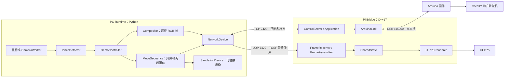
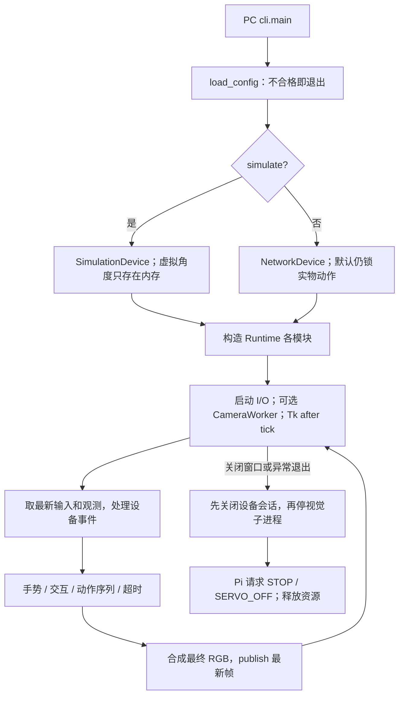
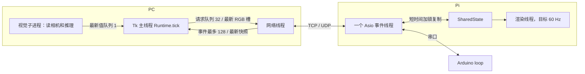
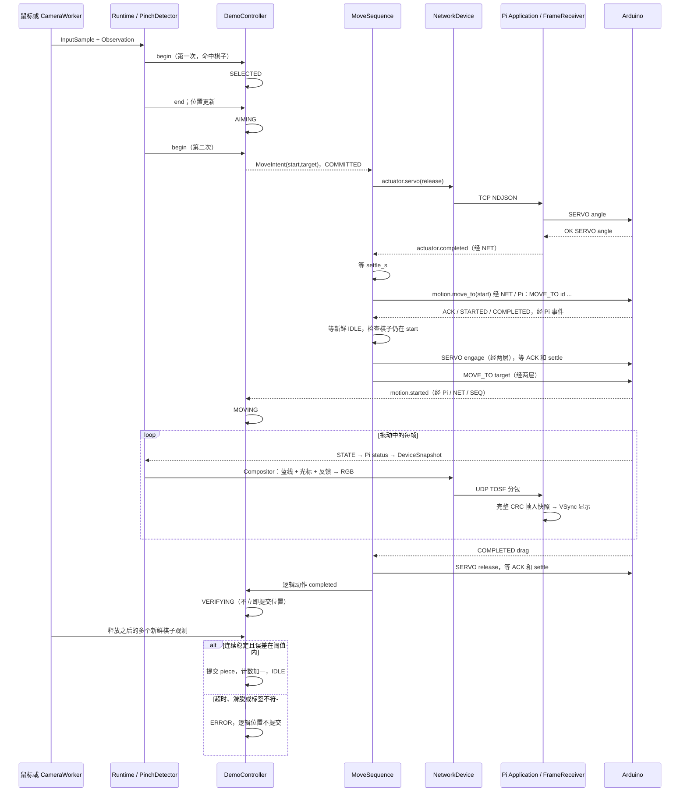
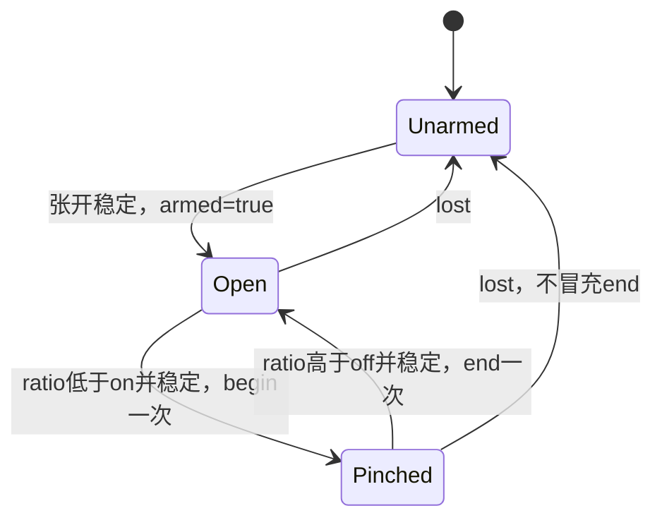
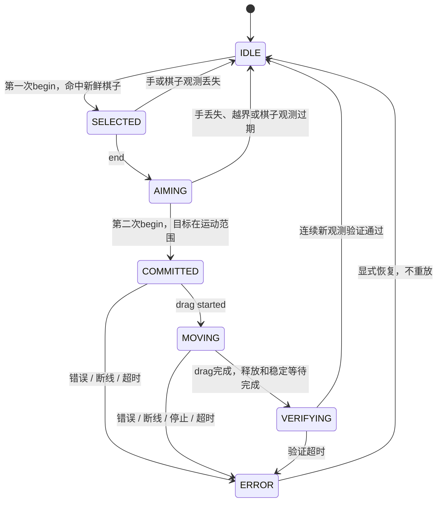
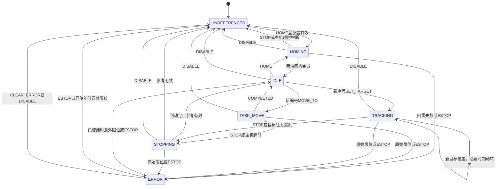
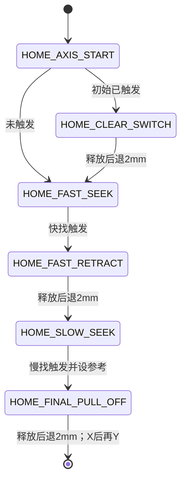
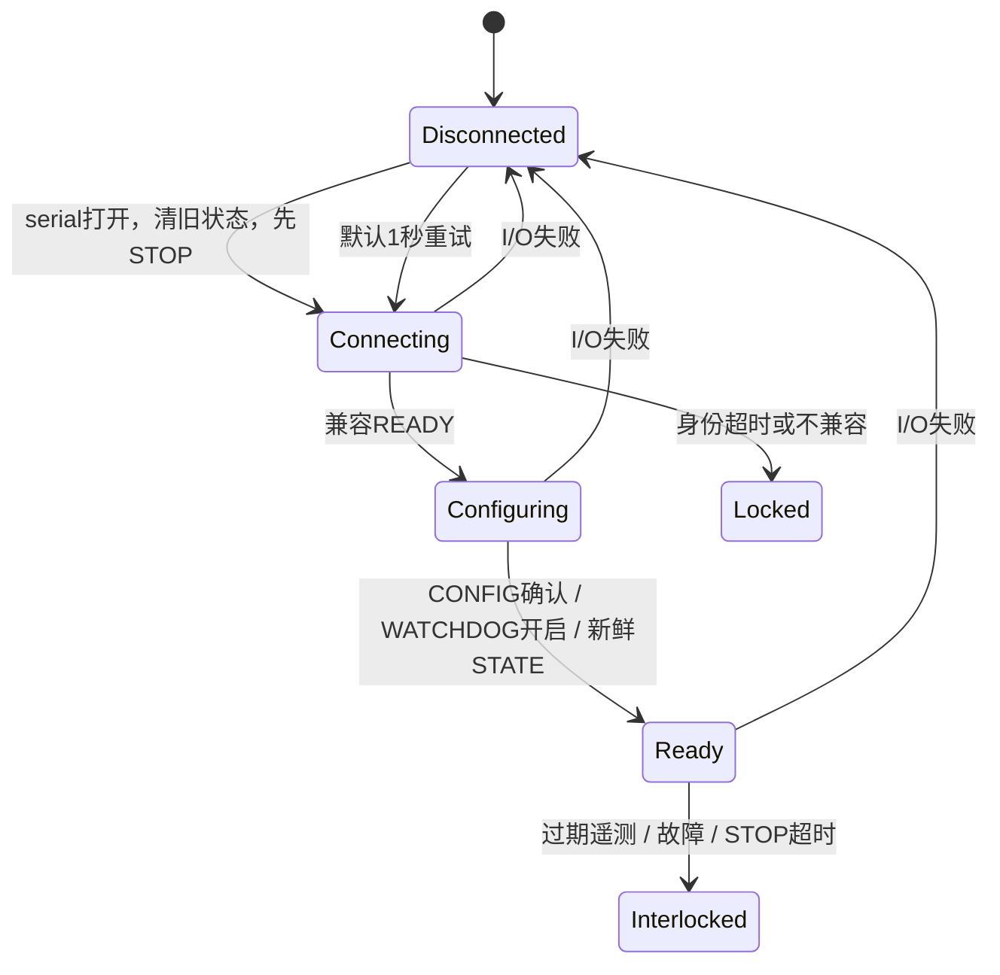

# Tabletop OS V0.1 中文技术说明书

> 更新日期：2026-10-16。本文对应本次工作区的 V0.1 软件实现，已从原先“只有 Pi/Arduino”的说明重写。代码文件指纹见 [CODE_REFERENCE_MANIFEST.json](CODE_REFERENCE_MANIFEST.json)，用 [校验工具](../tools/validate_technical_guide.py) 检查文档链接、关键符号和代码是否变化。
>
> **软件候选版已实现，实物闭环尚未验收。** 已有可运行的鼠标仿真、摄像头/MediaPipe/AprilTag 接口、双捏合交互、舵机升降永磁铁动作序列、PC RGB 合成、Pi 像素帧接收和 Arduino 固件。用户确认舵机角度尚未标定，默认实物动作锁定；本次没有连接相机、Pi、灯板或电机进行实测。编译、仿真和离线识别不能替代真实硬件验收。

面向读者：具备 Arduino、Physical Computing（实体交互计算）和基本编程知识，希望理解软件如何组织的开发者。建议先看 A/C/D，再按 I 运行；改效果看 G，诊断设备看 E/F，明天上机看[实机联调记录表](HARDWARE_COMMISSIONING_ZH.md)。路径以仓库根目录为基准；本文链接相对 `docs/`。

## A. 系统总体架构

### A.1 目标和概念

Tabletop OS 把“人的指向与确认”“确定的交互状态”“桌面视觉反馈”“物理执行”和“结果观测”连成闭环。手移动只改变光标；第一次捏合选中一个已观测到的棋子，松开后预览目标，第二次捏合才创建一次动作。电机完成后，系统还要看见棋子确实到达，才能提交位置。

Runtime（运行时）是管理输入、时间、状态、画面和设备生命周期的宿主。PC 的 `Runtime` 就是这一宿主。Device Service（设备服务）指 Pi 上独立运行的 `tabletop-os-bridge` 进程，负责硬件连接和联锁。Driver（驱动/适配器）把抽象操作变成具体 I/O，如 `NetworkDevice`、`ArduinoLink`、`Hub75Renderer`；这里不是内核驱动。Firmware（固件）是在 Arduino 上控制引脚的程序。Game Application（游戏应用）应拥有回合、规则和攻击，目前尚未实现，不能把 Pi 的 `Application` 类误当成游戏。

三层设计对应三种时间尺度：PC 做视觉与交互，Pi 做网络/USB 会话和 LED 输出，Arduino 做步进、限位和停止。网络调度的抖动不应直接决定步进脉冲间隔，Arduino 的小内存也不应承担图像处理。模块通过协议连接，先用仿真验证交互，再逐层换成真实设备。

### A.2 实际架构与依赖



PC 主循环拥有交互状态，`MoveSequence` 决定何时释放、定位、吸附、拖动和验证。Pi 再判断运动开关、租约、连接、配置、看门狗、遥测、参考和范围；Arduino 最后检查自身状态，并产生脉冲。三层都不能跳过下层的拒绝条件。

PC 已经合成最终画面。Pi 默认 `display.mode=frames`，只看 RGB 字节，不解释棋子或游戏特效。原有 UDP 7421 光标与 Pi 本地蓝线仍保留在 `mode=diagnostic`，用于独立排障；两个模式互斥，不重复叠加图层。

### A.3 逻辑与物理的权限

| 状态或操作 | 唯一主要所有者 | 其他模块的角色 |
| --- | --- | --- |
| 当前选择、目标预览、逻辑棋子位置 | PC `DemoController` | 视觉提供观测，设备提供结果；COMPLETED 本身不能提交棋子位置 |
| 升降/空载定位/拖动顺序 | PC `MoveSequence` | Pi 只接受通用 servo 和 move，不理解“取棋子” |
| PC 连接租约、在途设备请求 | Pi `Application` | 网络和串口适配器只传递数据 |
| A/B 脉冲计数、回零参考、限位和故障 | Arduino 固件 | Pi/PC 保存镜像，不能把目标位置写成实际位置 |
| 画面组成和轨迹历史 | PC `Compositor` | Pi 只重组完整帧、映射面板、调亮度并屏蔽红色 |

## B. 完整代码结构与模块说明

### B.1 项目目录树

以下省略 `.git/`、`.venv/`、build、tmp 和被忽略的模型二进制；这些不属于可编辑源码。测试文件是真正运行的测试，不是功能占位。

```text
Tabletop-OS/
├── README.md
├── .gitattributes
├── .gitignore
├── pc-runtime/
│   ├── README.md
│   ├── pyproject.toml
│   ├── apriltag_camera.py
│   ├── requirements.txt
│   ├── smoke_test.py
│   ├── config/runtime.json
│   ├── models/README.md
│   ├── models/hand_landmarker.sha256
│   ├── src/tabletop_os/
│   │   ├── __init__.py
│   │   ├── __main__.py
│   │   ├── cli.py
│   │   ├── config.py
│   │   ├── model.py
│   │   ├── runtime.py
│   │   ├── gestures.py
│   │   ├── interaction.py
│   │   ├── sequence.py
│   │   ├── render.py
│   │   ├── device.py
│   │   ├── frame_protocol.py
│   │   ├── simulation.py
│   │   ├── calibration.py
│   │   ├── vision.py
│   │   └── ui.py
│   ├── tools/
│   │   ├── download_hand_model.py
│   │   ├── calibrate_camera.py
│   │   ├── calibrate_servo.ps1
│   │   ├── make_apriltag.py
│   │   └── check_vision.py
│   └── tests/
│       ├── test_runtime.py
│       ├── test_frames.py
│       └── test_vision.py
├── pi-bridge/
│   ├── .gitignore
│   ├── CMakeLists.txt
│   ├── README.md
│   ├── config/tabletop-os.json
│   ├── include/tabletop_os/
│   │   ├── application.hpp
│   │   ├── arduino_link.hpp
│   │   ├── config.hpp
│   │   ├── control_server.hpp
│   │   ├── cursor_receiver.hpp
│   │   ├── frame_protocol.hpp
│   │   ├── frame_receiver.hpp
│   │   ├── hub75_renderer.hpp
│   │   └── shared_state.hpp
│   ├── src/
│   │   ├── main.cpp
│   │   ├── application.cpp
│   │   ├── arduino_link.cpp
│   │   ├── config.cpp
│   │   ├── control_server.cpp
│   │   ├── cursor_receiver.cpp
│   │   ├── frame_protocol.cpp
│   │   ├── frame_receiver.cpp
│   │   ├── hub75_renderer.cpp
│   │   ├── hub75_renderer_stub.cpp
│   │   └── shared_state.cpp
│   ├── tests/
│   │   ├── frame_protocol_test.cpp
│   │   └── test_bridge.py
│   ├── systemd/tabletop-os-bridge.service
│   └── tools/
│       ├── install_pi.sh
│       ├── send_control.ps1
│       └── send_cursor.ps1
├── firmware/
│   ├── arduino/TabletopOS_Lower_Controller/
│   │   ├── TabletopOS_Lower_Controller.ino
│   │   └── README_中文.md
│   └── tests/
│       ├── lower_controller_test.cpp
│       └── fakes/
│           ├── Arduino.h
│           └── Servo.h
├── protocol/
│   ├── README.md
│   ├── control-v1.schema.json
│   └── frame-v1.json
├── tools/validate_technical_guide.py
├── experiments/
│   ├── arduino/CoreXY_Controller/{CoreXY_Controller.ino, README_中文.md}
│   ├── arduino/Limit_Servo_Test/{Limit_Servo_Test.ino, README_中文.md}
│   ├── arduino/Integrated_Hardware_Test/{Integrated_Hardware_Test.ino, README_中文.md}
│   └── raspberry-pi/gpio_high_test.py
├── hardware/
│   ├── datasheets/DELIXI_CDKU-S_datasheet.pdf
│   └── reference/DELIXI_CDKU-S200_official_dimension_drawing.png
└── docs/
    ├── TABLETOP_OS_TECHNICAL_GUIDE_ZH.md
    ├── HARDWARE_COMMISSIONING_ZH.md
    ├── CODE_REFERENCE_MANIFEST.json
    ├── VALIDATION_2026-10-16.md
    ├── Tabletop_OS_Project_Context.md
    ├── Tabletop_OS_Development_Roadmap.md
    └── Tabletop_OS_中文路径规划图.md
```

### B.2 PC Runtime：输入到状态和输出

下面链接都指向实际源文件。输入/输出多为内存对象，不代表每个模块都是独立进程。

| 文件 / 核心类或函数 | 输入 → 输出 | 调用者、时机、依赖与设计原因 |
| --- | --- | --- |
| [cli.py](../pc-runtime/src/tabletop_os/cli.py)、[__main__.py](../pc-runtime/src/tabletop_os/__main__.py)：`main()`、`run_demo()`、`scripted_input()` | CLI 参数 → GUI 或仿真结果 JSON/退出码 | Python 入口调用；先加载配置；自动 Demo 只允许 simulate+headless，防止脚本意外驱动实物 |
| [config.py](../pc-runtime/src/tabletop_os/config.py)：`RuntimeConfig`、各配置 dataclass、`load_config()` | JSON → 有类型配置或 ValueError | CLI、工具调用；拒绝未知字段、NaN、非法类型/范围；相对模型/标定路径以配置文件目录解析，机器角度不藏在代码里 |
| [model.py](../pc-runtime/src/tabletop_os/model.py)：`Point`、`InputSample`、`Observation`、`MoveIntent`、`DeviceSnapshot`、`snapshot_from_message()` | 输入/观测/设备 JSON → 不可变值对象 | 各模块共享；`can_move/can_operate_servo` 把遥测年龄加上状态接收后的时间，防止旧快照伪装新状态 |
| [runtime.py](../pc-runtime/src/tabletop_os/runtime.py)：`Runtime.start/tick/home/stop/reset/close`、`_home_events` | 输入样本、观测、设备事件 → 状态推进、请求、最终 RGB | Tk 或 headless 每帧调用；拥有 controller、pinch、sequence、compositor、device；只有主线程修改交互状态；HOME 也先释放磁铁 |
| [gestures.py](../pc-runtime/src/tabletop_os/gestures.py)：`PinchDetector.update()` | 距离比值和单调时间 → begin/end/lost/None | Runtime 在新输入帧到达时调用；迟滞、去抖和重新武装分开，维持捏合不重复触发 |
| [interaction.py](../pc-runtime/src/tabletop_os/interaction.py)：`Phase`、`DemoController.input/observe/event/tick/take_intent` | 手势边沿、棋子观测、逻辑任务结果 → MoveIntent 或状态变化 | Runtime 调用；保存 piece/target/request_id/command_id、截止时间和验证计数；只用新鲜且不同时间的观测提交位置 |
| [sequence.py](../pc-runtime/src/tabletop_os/sequence.py)：`MoveSequence.begin/update/_dispatch/abort` | MoveIntent、设备快照和事件 → servo/move 请求 | Runtime 调用；只有一个阶段和一个在途请求；每次等确认与稳定时间后才发下一步，出错发 stop、不自动重放 |
| [render.py](../pc-runtime/src/tabletop_os/render.py)：`Compositor.pixel/put/circle/record/render` | 交互状态、执行器遥测、时间 → 12288 字节 RGB | Runtime 每帧调用；有界 deque 保存拖影；纯绘制不调用设备，便于单独测试和修改 |
| [device.py](../pc-runtime/src/tabletop_os/device.py)：`NetworkDevice`、`_run/_session_loop` | request/publish → TCP/UDP；网络 → snapshot/poll | Runtime 使用；独立 I/O 线程维持心跳和重连；命令队列上限 32、事件 128，图像只有最新一帧；掉线清队列避免延迟重放 |
| [frame_protocol.py](../pc-runtime/src/tabletop_os/frame_protocol.py)：`encode_frame()`、`FrameAssembler.feed()`、`newer32()` | RGB ↔ TOSF 数据报 | NetworkDevice 编码；Python decoder 用于参考/测试；与 C++ 用真实网络测试互证，不靠 JSON 传 RGB |
| [simulation.py](../pc-runtime/src/tabletop_os/simulation.py)：`SimulationDevice.request/tick/observation` | 同样的设备请求和虚拟时间 → 独立执行器/棋子位置、事件 | Runtime 在 simulate 模式替换网络设备；支持滑脱和标签丢失；不是把目标直接当成功观测 |
| [calibration.py](../pc-runtime/src/tabletop_os/calibration.py)：`Calibration.map/load/save`、`from_corners()` | 像素/四角与桌面尺寸 → 毫米映射和 JSON | 标定工具创建，视觉进程读取；拒绝退化四边形、分辨率/桌面尺寸不符；文件原子替换 |
| [vision.py](../pc-runtime/src/tabletop_os/vision.py)：`CameraWorker`、`camera_process()`、`hand_sample()`、`AprilTagDetector.detect()`、`VisionResult` | 相机图像 → 手位置/距离比、棋子 ID/毫米观测、预览 | 独立进程拥有 cv2 VideoCapture 和 MediaPipe Tasks；阻塞采集/推理不能卡住网络；输出最新值队列容量 1 |
| [ui.py](../pc-runtime/src/tabletop_os/ui.py)：`run_window()` | Tk 鼠标/按键或视觉结果 → Runtime.tick 和显示 | Tk after 回调驱动主循环；显示模式、目标、执行器、观测、错误和验证计数；仿真可勾选滑脱/标签丢失 |

<!-- code-ref: pc-runtime/src/tabletop_os/runtime.py::Runtime.tick -->
<!-- code-ref: pc-runtime/src/tabletop_os/interaction.py::DemoController.observe -->
<!-- code-ref: pc-runtime/src/tabletop_os/sequence.py::MoveSequence.update -->
<!-- code-ref: pc-runtime/src/tabletop_os/gestures.py::PinchDetector.update -->
<!-- code-ref: pc-runtime/src/tabletop_os/vision.py::camera_process -->

`__init__.py` 定义版本；`pyproject.toml` 声明 Python≥3.11、入口和可选 vision 依赖。模拟核心只用标准库；实际视觉额外安装锁定版本的 MediaPipe、OpenCV contrib 和 NumPy。`models/README.md` 与 sha256 记录模型来源，二进制被忽略且不自动下载。

仓库还保留独立的 [apriltag_camera.py](../pc-runtime/apriltag_camera.py) 摄像头原型。其 `parse_args/open_camera/main` 在单进程循环中采集和检测，`detection_observation/draw_detection/emit_observations` 生成像素观测、叠加预览和 stdout 文本或 NDJSON。它使用 pupil-apriltags，默认相机索引1、1920×1080、最多10次/秒输出；`vision.tags` 包含 seq、墙钟 captured_at_ms、camera、tags，每个 tag 包含 ID、中心/四角像素、heading_deg、decision_margin 和 hamming；无标签时 tags 为空。该输出尚无 Runtime 消费者，不会驱动设备，也不替代正式 `vision.py` 的毫米观测与手势输入。主循环同步等待采集和检测，Q/Esc 或 Ctrl+C 退出；清理时释放相机和预览窗口。独立 [requirements.txt](../pc-runtime/requirements.txt) 的版本与正式 Runtime 不同，按 PC README 使用 `.venv-apriltag`，避免混装。其 [smoke_test.py](../pc-runtime/smoke_test.py) 的 `main()` 生成 ID7 标签，检查检测、叠加和 NDJSON，写入被忽略的 outputs；本次合并只做语法检查，未重新安装原型依赖或运行该原型。

### B.3 Pi 设备服务

同名 `.hpp` 在 `include/tabletop_os/` 声明接口，`.cpp` 在 `src/` 实现。多个 I/O 类用 Pimpl 隐藏 socket/队列细节，调用者只依赖小接口。它们同属一个进程。

| 源文件 / 核心符号 | 输入输出、调用者与关键状态 |
| --- | --- |
| [main.cpp](../pi-bridge/src/main.cpp)：`ParseArguments/main` | OS 启动 → 配置、状态、显示、Application；登记退出信号，执行 io.run，最后 join/清屏 |
| [config.cpp](../pi-bridge/src/config.cpp)、[config.hpp](../pi-bridge/include/tabletop_os/config.hpp)：`LoadConfig/Validate`、`AppConfig` | JSON → 固定配置；整数先查原始范围避免窄类型回绕，浮点要求有限；缺字段取默认，未知键目前不拒绝 |
| [application.cpp](../pi-bridge/src/application.cpp)：`Application`、`HandleControlMessage/HandleSerialLine`、`ScheduleMaintenance`、`SendSafetyStop` | 网络/串口事件 → 语义检查、串口命令、状态回复；拥有租约、任务/servo 在途、最近 64 个请求 ID、命令/STOP/servo 超时、身份重试 |
| [control_server.cpp](../pi-bridge/src/control_server.cpp)：`ControlServer::Impl::State`、`HandleRead/HandleLine/Enqueue` | TCP 字节流 ↔ NDJSON；只接一个客户端；行缓冲 4096，输出最多 64 条，可替换状态避免慢客户端回放旧快照 |
| [cursor_receiver.cpp](../pi-bridge/src/cursor_receiver.cpp)：`CursorReceiver`、`HandleReceive` | UDP 7421 JSON → 光标回调；用于诊断模式，保存发送端但不绑定控制会话 |
| [frame_receiver.cpp](../pi-bridge/src/frame_receiver.cpp)：`FrameReceiver.Start/SetSession/Receive/Stop` | UDP 7422 → 完整 RGB 帧；会话由 TCP display.open 设置，断线/租约失效清空；不理解图层 |
| [frame_protocol.cpp](../pi-bridge/src/frame_protocol.cpp)：`FrameAssembler::Feed/SetSession` | 有界分包 → optional RGB；乱序接收、CRC32、序号回绕、100 ms 组帧超时；只容纳一张待组帧 |
| [arduino_link.cpp](../pi-bridge/src/arduino_link.cpp)：`ArduinoLink`、`OpenSerial/BeginRead/BeginWrite/HandleDisconnect` | 行命令 ↔ USB；strand 串行化，连接代数拒绝旧回调；断线丢队列，urgent STOP 清掉未发送普通工作 |
| [shared_state.cpp](../pi-bridge/src/shared_state.cpp)、[shared_state.hpp](../pi-bridge/include/tabletop_os/shared_state.hpp)：`SharedState` | 光标/遥测/RGB → 带锁快照；保存 CursorState、MotionState、TrailPoint、RgbFrame；通信写、渲染读副本 |
| [hub75_renderer.cpp](../pi-bridge/src/hub75_renderer.cpp)：`Hub75Renderer::Impl::Initialize/Render/RenderLoop` | 快照 → HUB75 后缓冲；frames 模式只输出 PC 帧，过期变黑；diagnostic 模式调用旧 DrawTrail/DrawCursor |
| [hub75_renderer_stub.cpp](../pi-bridge/src/hub75_renderer_stub.cpp)：`TimingLoop` | 状态 → 定时取快照，无 GPIO/像素预览；编译选项 OFF 时替换真实 renderer |

<!-- code-ref: pi-bridge/src/application.cpp::Application::HandleControlMessage -->
<!-- code-ref: pi-bridge/src/frame_protocol.cpp::FrameAssembler::Feed -->
<!-- code-ref: pi-bridge/src/shared_state.cpp::SharedState::UpdateFrame -->

### B.4 Arduino、工具、测试与保留资料

正式固件：[TabletopOS_Lower_Controller.ino](../firmware/arduino/TabletopOS_Lower_Controller/TabletopOS_Lower_Controller.ino)。它是单个 Arduino 草图，不是 RTOS，也不继承 Driver 基类。

| 功能域 / 核心函数和结构 | 输入 → 输出、状态与调用关系 |
| --- | --- |
| `setup/loop` | 初始化后重复调用 service 函数；上电禁用电机且无舵机脉冲 |
| `Mode/FaultCode/HomePhase/StopReason` | 模式、错误、回零阶段、停止原因；全局 mode/reference/fault 控制许可 |
| `MotionPlan/startMotionPlan/serviceMotionPlan/finishMotionPlan` | 毫米目标 → DDA 双电机事件和速度计划 → COMPLETED/CANCELLED/STOPPED；一个活动计划，不排长队 |
| `emitStepEvent/xFromMotorSteps/yFromMotorSteps/setAxisCoordinate` | A/B 引脚与计数 ↔ 桌面毫米；坐标是开环估计，不是编码器反馈 |
| `startHoming/serviceHoming/beginHomeAxis/setHomePhase/failHoming` | HOME → X 再 Y 的快找、退回、慢找、退回；限位建立参考，预算失败进入 ERROR |
| `serviceSerialInput/processCommand/parseUnsignedLongStrict/parseFloatStrict` | 字符 → 96 字节行缓冲 → 命令；! 不等换行；uint32 显式检查溢出 |
| `startTaskMove/updateTrackingTarget/isNewer32` | 编号任务或最新目标 → ACK/拒绝/计划；重复活动 ID 不重新启动，旧目标不覆盖新目标 |
| `requestControlledStop/startBrakePlan/emergencyStop/enterFault` | 受控制动或立即禁用输出；前者尽量保留参考，后者作废参考 |
| `updateLimitDebounce/serviceUnexpectedLimits` | 引脚 → 稳定限位/故障；回零使用 20 ms 消抖，正常运动看原始限位以优先停止 |
| `serviceHostWatchdog/serviceTargetTimeout/serviceServoTimeout` | 时间戳 → 主机/目标失联停止或舵机信号关闭 |
| `printState/printIoState/printConfiguration/serviceTelemetry` | 内部状态 → ASCII 行；CONFIG 额外回 LAST_TASK_ID 供 Pi 同步编号 |
| `setServoAngle/servoOff` | 通用角度/PWM 开关；不包含磁铁电源控制，也不理解 pickup/release |

<!-- code-ref: firmware/arduino/TabletopOS_Lower_Controller/TabletopOS_Lower_Controller.ino::serviceMotionPlan -->
<!-- code-ref: firmware/arduino/TabletopOS_Lower_Controller/TabletopOS_Lower_Controller.ino::serviceHoming -->

Arduino 接线：A STEP/DIR=D2/D5，B=D3/D6，公共低有效 EN=D8；X/Y 限位 D9/D10；舵机 D11。当前为内部上拉 + COM 接 GND、NO 接信号，`SWITCH_NORMALLY_CLOSED=false`。舵机供电/接线详见[固件说明](../firmware/arduino/TabletopOS_Lower_Controller/README_中文.md)。

工具 `download_hand_model.py` 下载并校验固定模型；`calibrate_camera.py` 通过四角生成标定；`make_apriltag.py` 生成白边 36h11 标签；`check_vision.py` 只检查视觉、不连设备；`calibrate_servo.ps1` 禁用电机后测试一个显式角度。Pi 的 `install_pi.sh` 建用户/编译/复制配置和 service，已有 `/etc` 配置会保留；systemd 管理进程与 journal。`send_control.ps1` 是一次性请求，`send_cursor.ps1` 是诊断光标，不能当作持久运动客户端。

Python tests 验证交互、仿真、帧和离线视觉；Pi tests 测真实 C++ decoder 与本机网络进程；`firmware/tests` 直接包含正式 `.ino`，只把 Arduino/Servo HAL 换成内存实现。假 HAL 不证明真实时序、供电或负载正确。

`experiments` 保留旧点动、限位/舵机、联合硬件测试与 GPIO 脚本。旧 CoreXY 草图是阻塞式 MOVE/JOG、手动 ZERO、示例 80 steps/mm，不能作为正式 100 steps/mm 固件或 Pi 协议替代品。上传实验草图后须重新上传正式固件。hardware 两份 DELIXI 文件是机械/开关参考，不被程序读取。历史 Context/Roadmap 可能包含旧边界，现有行为以当前源码和本文为准。

## C. Runtime 与任务调度

### C.1 主循环、事件循环和工作单元

主循环是重复执行当前工作；事件循环是在输入或定时器就绪时执行回调。异步 I/O 是登记操作后等待完成通知，不等于自动开线程。

| 组件 | 实际调度方式 | 阻塞隔离 |
| --- | --- | --- |
| PC UI/交互/合成 | Tk 主线程 `after` → Runtime.tick；无头 Demo 显式推进虚拟时间 | 不等待网络或摄像头；每帧只取最新输入/状态 |
| PC 网络 | 一个 `device-io` 工作线程，socket + select、小超时 | TCP 连接/发送可能阻塞，但不占 UI；心跳需主循环仍定期 publish，否则主动断开 |
| PC 相机/视觉 | 一个 spawn 子进程：采集、MediaPipe VIDEO 同步推理、AprilTag | 队列容量 1，丢旧结果；采集若卡死可终止该进程，不能拖住全程序 |
| Pi TCP/UDP/串口/维护 | 主线程一次 `boost::asio::io_context::run()` | 异步读写和 steady_timer；serial open、JSON、日志仍是同步短工作 |
| Pi LED | 一个显式 std::thread + HUB75 库自身刷新机制 | VSync/sleep 不占网络事件线程；锁只用于复制 SharedState |
| Arduino | 单个 loop，底层串口/Servo 中断由平台库管理 | 到期才发一组脉冲，不在长运动循环中等完成 |



PC 初始化不自动 HOME，不自动下载模型，也不自动启用网络运动。真实动作要求 camera 模式，防止鼠标坐标冒充真实棋子观测。仿真会用同一 Runtime/Controller/Sequence/Compositor，只替换输入和设备。



Pi `main()` 顺序：ParseArguments → LoadConfig → 可选 check-config 返回 → SharedState/Hub75Renderer → Initialize → io_context/Application → 信号回调 → renderer.Start/application.Start → io.run。HUB75 先初始化，是为了让库先获得硬件权限，再按配置降权，然后打开串口。`--check-config` 不触碰硬件，但也不证明串口和 mapper 可用。

### C.2 Arduino 非阻塞运动

真实循环节选：

```cpp
void loop() {
  unsigned long nowMs = millis();
  updateLimitDebounce(nowMs);

  // Motion service stays before verbose serial/telemetry work.
  serviceHoming();
  serviceMotionPlan();
  serviceSerialInput();
  serviceUnexpectedLimits();
  // Serial commands timestamp themselves with millis(). Refresh now so elapsed
  // time cannot underflow if a command crossed the loop's millisecond boundary.
  nowMs = millis();
  serviceHostWatchdog(nowMs);
  serviceTargetTimeout(nowMs);
  serviceServoTimeout(nowMs);
  serviceTelemetry(nowMs);
}
```

`startMotionPlan()` 只建立 MotionPlan；`serviceMotionPlan()` 比较 micros 与 nextEventAtUs，未到期立刻返回，到期最多输出一组脉冲。DDA（数字差分插补）的 errorA/errorB 累加器决定本次哪个电机走一步。速度受加速度和剩余距离制动关系 `sqrt(2*a*s)` 限制，无路径前瞻。

串口处理后必须重新读取 `millis()`，再检查主机、目标和舵机超时。否则串口命令记录的时间可能比本轮入口时间晚 1 ms，无符号相减会误判为超时，导致持续收到 PING 的回零仍报 `HOST_TIMEOUT`。2026-10-23 增加了跨毫秒边界的回归测试；真实失联 1500 ms 的停止保护保持不变，修复版仍需重新上传 Uno 并完成实机复测。

当前 A=(X+Y)×100、B=(X−Y)×100，再乘轴方向符号；反算 X=(A+B)/200、Y=(A−B)/200。100 steps/mm 来自 200 整步×16 细分÷(2 mm 齿距×16 齿)。软件常量不会改变 A4988 跳帽。

非阻塞不等于零等待：emitStepEvent 有 4 µs 脉宽等待；Serial.print 仍可能等待缓冲，遥测仅检查可写至少 32 字节，而完整 STATE 可能更长；输入 while available 排空也可能拖长一轮。4000 events/s 是计划上限，不能当成已测实时能力。

### C.3 退出与故障资源清理

PC 先通知设备线程结束；线程尝试发 motion.stop 并关闭 TCP/UDP，Pi 断线回调也请求停止。随后 CameraWorker 发 stop，等待 2 秒；若 read 卡死则 terminate 隔离进程。相机进程正常 finally 关闭 landmarker/release capture。网络线程 join 上限 3 秒，连接/收发有小超时。

Pi 收 SIGINT/SIGTERM 后取消维护/握手，隐藏光标、清显示会话、关 TCP/UDP，串口连接时优先 STOP 和 SERVO_OFF；等 STOPPED 或 750 ms 退出宽限后关串口。异步工作排空后 io.run 返回，渲染线程 join 并交换黑帧。串口 STOP 超过 2500 ms 未确认时会停用串口并要求重启服务，避免一直给未知状态续命。Arduino 的主机看门狗是后备保护。

停止 PWM 不等于切舵机电源，也不保证永磁铁立即释放；掉电后升降机构是否下落须实测。软件 STOP 不是物理急停。

## D. 完整交互流程

### D.1 双捏合 Demo 的实际调用链

| 阶段 | 首个接收模块、数据与路径 | 状态、通信、等待和恢复 |
| --- | --- | --- |
| 手移动 | CameraWorker 输出 InputSample(position、pinch_ratio、timestamp)，或 Tk 鼠标样本 → Runtime.tick | 新帧才更新手势检测，250 ms 过期当 lost；只更新光标，无运动 |
| LED 光标 | Compositor.render → RGB bytes → NetworkDevice.publish → encode_frame → UDP 7422 | Pi FrameReceiver 组完整帧 → SharedState → 下一渲染 tick/VSync 输出 |
| 第一次捏合 | PinchDetector 返回 begin → DemoController.input | 新鲜 ID=0 观测且光标距棋子≤22 mm 才 SELECTED；只是绿色选中圈 |
| 释放并移光标 | end → AIMING；连续位置更新 target | 不发 MOVE；越界/手丢失/观测过期取消选择；第一次释放不提交 |
| 第二次捏合 | begin → COMMITTED，生成一个 MoveIntent；take_intent 取走一次 | Runtime 交 MoveSequence.begin；未标定、设备不安全则 ERROR，不启动任务 |
| 抬起和空载定位 | actuator.servo(release) → 串口 SERVO → actuator.completed；等 settle_s，再 motion.move_to(start) | 每阶段有唯一 request_id；等 seek 完成且新鲜 IDLE，才检查棋子仍在原处 |
| 放下和拖动 | actuator.servo(engage) ACK+等待；motion.move_to(target) → MOVE_TO | drag STARTED 才进入 MOVING；执行器需处于拾取容差 3 mm 内；Pi 保持舵机目标每 2 秒刷新 |
| 蓝色拖影 | Arduino STATE 的 actual → Pi status → DeviceSnapshot → Compositor.record | 只在 DRAG 的 TASK_MOVE/STOPPING 记录；空载 SEEK 不画蓝线；按年龄衰减 |
| 释放与完成验证 | drag COMPLETED 后发 release，ACK+settle，再 DemoController.event 进入 VERIFYING | 必须收到释放稳定之后的新棋子观测，连续 3 个不同时间样本距目标≤5 mm 才提交；5 秒失败为 ERROR |

“ACK”只说明固件接受了目标角度，没有舵机编码器反馈；settle_s 是等待时间，不是实测角度确认。完整动作使用两个 MOVE_TO（seek 和 drag），不是直接把执行器从任意位置拖向目标。



网络断线、Pi 联锁、取消/停止、固件错误、请求超时会使 MoveSequence.abort 发 stop 并进入 ERROR。恢复按钮只清交互，不重发旧动作；必须先处理物理原因、必要时清固件错误并 HOME，再用新观测重新选择。运动确认后手暂时离开不撤销已提交动作，终点仍必须通过棋子观测。

## E. 状态机与数据管理

### E.1 手势与选择是两套状态

PinchDetector 用比值≤0.25 触发、≥0.40 释放，摄像头默认稳定 60 ms；鼠标去抖为 0，便于普通点击。初次看见手若已捏住，不立刻触发，需先张开重新 armed；lost 清除 armed，避免遮挡后的捏住误作第二次确认。Runtime 不会把同一旧相机帧反复送入去抖器。





MoveSequence 的阶段是 RELEASE → SETTLE_RELEASE → SEEK → ENGAGE → SETTLE_ENGAGE → DRAG → RELEASE_FINAL → SETTLE_FINAL → IDLE。每次只拥有一个 request_id。设备完成后可能晚一帧才收到 IDLE 状态，所以 `_dispatch` 还等新鲜安全快照，而不是在同一回调立即连发。

### E.2 固件与连接状态



TRACKING 到当前目标后仍等更新，500 ms 目标超时才停止；没有任务式完成。STOP 在静止或 ERROR 时只回 ALREADY_STATIONARY，不清错误。DISABLE 立即释放且作废参考，不能代替制动。CLEAR_ERROR 之后仍须回零。



快找预算为轴行程+80 mm；清开关/退回上限20 mm；慢找上限12 mm；速度8/2 mm/s。超出预算报 NOT_FOUND/STUCK。HOME 保持已明确设定的舵机信号，让 PC 先抬起的磁铁在回零时保持；Pi 继续每2秒刷新，固件10秒舵机超时仍存在。



Pi 连接状态实际由多个布尔值组成，没有统一 DeviceState 枚举。TCP 连接与串口连接独立；TCP 收到合法 heartbeat 才获得运动租约。网络客户端自己只要主循环不再 publish，默认1500 ms后也会停止续命并关闭会话。

### E.3 三种位置与一致性

| 数据 | 来源与权限 | 不能用它推断的事 |
| --- | --- | --- |
| 逻辑目标/目标预览 | DemoController.target / MoveIntent | 玩家还没第二次捏合时不能据此驱动机构 |
| 执行器位置 actual | Arduino positionA/B 脉冲计数 → STATE → Pi镜像 → PC快照 | 不是编码器，不知道皮带滑动、丢步或棋子掉队 |
| 棋子观测位置 | CameraWorker AprilTag 或仿真的独立 piece | 标签丢失表示未知，不能把最后位置当新观测 |
| 已提交棋子位置 piece | IDLE 时跟随新观测；任务后仅验证通过才提交 | COMPLETED/目标位置不能替代视觉成功 |

PC 主线程是交互状态唯一写者，输入值对象不可变；网络通过锁保护最新快照和有界队列，视觉通过进程队列传值。Pi SharedState 用 mutex，渲染拿副本后释放锁再等 VSync。只有 Arduino 写步数。不能给 Pi io_context 随意增加 run 线程：Application 和 ControlServer 还依赖当前串行事件线程。

防重分三层：take_intent 只取一次；Pi 最近64个已接受 request_id 再用时报 DUPLICATE_REQUEST（在途时也可能先报 COMMAND_PENDING）；Arduino 同活动ID只再ACK、结束后旧ID报 STALE_ID。不是持久 exactly-once：Pi 重启丢缓存，客户端不能盲重发。Pi 从 CONFIG LAST_TASK_ID+1 分配ID并跳过0，跨Pi重启不再依赖时钟种子；缺该字段的旧固件会锁住MOVE。

## F. 通信协议

### F.1 实际通道和分帧

| 方向 | 协议/默认配置 | 边界、编码与接收端 |
| --- | --- | --- |
| PC↔Pi控制 | TCP7420，network.control_port | UTF-8 NDJSON，LF结尾兼容CRLF；ControlServer累积半行，一次read可含多行 |
| PC→Pi最终图像 | UDP7422，network.frame_port | TOSF二进制分包；FrameReceiver→FrameAssembler，完整CRC通过才提交 |
| PC→Pi诊断光标 | UDP7421，network.cursor_port | 一个数据报一个JSON，不重组JSON；CursorReceiver→HandleCursorMessage |
| Pi↔Arduino | USB 115200 baud、8N1、无流控 | ASCII行；Arduino收CR或LF，Pi按LF并去尾CR；!无需行尾 |
| Pi→HUB75 | 本地库与GPIO | 不经过TCP/串口，不是图像网络协议 |

没有WebSocket/MQTT/HTTP实时服务；SSH仅部署。TCP每行默认最多4096字节，坏JSON回INVALID_JSON并保留连接，超长回CONTROL_LINE_TOO_LARGE后关闭。第二个控制连接回CONTROL_CLIENT_BUSY。Pi串口输入缓冲上限8192，找不到换行且溢出按断线重连。Arduino输入最多95个有效字符，溢出报LINE_TOO_LONG并丢到行尾；Pi的4096发送上限不等于固件接受长度。

规范入口：[control-v1.schema.json](../protocol/control-v1.schema.json)、[frame-v1.json](../protocol/frame-v1.json)。JSON schema描述请求形状，机械范围和会话许可仍由服务运行时决定。

### F.2 TCP控制消息

下面每个对象在实际发送时各占一行并附LF。v缺省兼容1，PC总显式发送。request_id可字符串或整数，Pi回复关联时统一成字符串；HOME/MOVE/SERVO要求非空且≤128字符。

```json
{"v":1,"type":"heartbeat","request_id":"hb-1"}
{"v":1,"type":"status.get","request_id":"status-1"}
{"v":1,"type":"ping","request_id":"ping-1"}
{"v":1,"type":"display.open","request_id":"display","session":123}
{"v":1,"type":"actuator.servo","request_id":"lift-1","angle":70}
{"v":1,"type":"motion.home","request_id":"home-1"}
{"v":1,"type":"motion.move_to","request_id":"move-1","x_mm":20,"y_mm":20,"speed_mm_s":2}
{"v":1,"type":"motion.stop","request_id":"stop-1"}
{"v":1,"type":"actuator.servo_off","request_id":"off-1"}
```

70只是消息形状例子，不是安全角度。发送端在NetworkDevice.request/_write，接收端在Application.HandleControlMessage。

| 请求 | 行为/回复 |
| --- | --- |
| heartbeat | 唯一续租请求；heartbeat.ack；默认400ms发送 |
| ping/status.get | pong/status，读取Pi镜像；不续租，不直接请求新Arduino STATUS |
| display.open | 有有效租约才设非零uint32会话，清旧帧，回display.opened；session用于图像隔离，不是身份认证 |
| actuator.servo | 安全开关、租约、无在途、同步编号、设备ready/配置/看门狗/新鲜遥测/无故障，模式IDLE或UNREFERENCED；发SERVO，等OK SERVO才回actuator.completed；角度到达仍靠settle而非编码器 |
| motion.home | 包含新版编号同步的联锁通过后发HOME；等ACK/STARTED/COMPLETED HOME映射事件 |
| motion.move_to | 另需referenced、IDLE、同步编号、有限坐标/速度和范围；分配id，发MOVE_TO |
| motion.stop | 不要求租约，串口已连接才发送；立即ack STOP_SENT/STOP_PENDING，稍后motion.stopped才是停止回报 |
| actuator.servo_off | 不要求租约；停止舵机续命并发SERVO_OFF，立即ack SERVO_OFF_SENT，尚无独立关信号确认事件 |

常见Pi拒绝码：MOTION_DISABLED、CONTROL_LEASE_EXPIRED、COMMAND_PENDING、ARDUINO_DISCONNECTED/NOT_READY、ARDUINO_CONFIG_UNCONFIRMED、ARDUINO_WATCHDOG_OFF、TELEMETRY_STALE、ARDUINO_FAULT、NOT_HOMED、BUSY、RANGE、BAD_MESSAGE、UNKNOWN_TYPE、UNSUPPORTED_VERSION、REQUEST_ID_REQUIRED、DUPLICATE_REQUEST、COMMAND_ID_NOT_SYNCHRONIZED。运行中还可能COMMAND_TIMEOUT、SERVO_TIMEOUT、SERVO_CANCELLED、ARDUINO_HANDSHAKE_TIMEOUT。

```json
{"v":1,"type":"motion.accepted","reply_to":"move-1","command_id":142}
{"v":1,"type":"motion.started","reply_to":"move-1","command_id":142}
{"v":1,"type":"motion.completed","reply_to":"move-1","command_id":142}
{"v":1,"type":"actuator.completed","reply_to":"lift-1","angle":70}
{"v":1,"type":"error","reply_to":"move-1","code":"MOTION_DISABLED"}
{"v":1,"type":"arduino.error","related_id":142,"code":"LIMIT_X","raw":"ERROR LIMIT_X 142","reply_to":"move-1"}
```

BuildStatusMessage输出v/type、control_connected、control_lease_valid、motion_commands_enabled、motion_command_in_flight、command_id_synchronized，以及cursor、display、arduino对象。cursor含visible/seq/x_mm/y_mm/gesture/age_ms；display含mode/frame_seq/session/frame_age_ms；arduino含connected/ready/firmware_compatible/config_confirmed/watchdog_enabled/referenced/mode/active_id/actual_x_mm/actual_y_mm/target_x_mm/target_y_mm/fault/telemetry_age_ms。age=-1表示尚无时间戳。age是Pi收到数据后的年龄，不是相机曝光到动作的端到端延迟。

### F.3 最终RGB帧：TOSF v1

PC encode_frame 与Pi FrameAssembler::Feed使用同一26字节大端头：

| offset | 长度 | 字段 |
| --- | --- | --- |
| 0 | 4 | ASCII TOSF |
| 4 / 5 | 各1 | version=1 / reserved=0 |
| 6 / 8 | 各2 | width=64 / height=64 |
| 10 / 14 | 各4 | 非零session / uint32 frame_id |
| 18 / 20 | 各2 | chunk_index（0–10）/ chunk_count=11 |
| 22 | 4 | 整张RGB的CRC-32/ISO-HDLC，同zlib.crc32 |

后接像素分块，按y行、x列、RGB三个字节；总12288字节，前10块各1200，末块288，单包最大1226字节。Python结构格式为 `!4sBBHHIIHHI`。例如session123、frame77、第一块的头前22字节十六进制是：

```text
54 4f 53 46 01 00 00 40 00 40 00 00 00 7b 00 00 00 4d 00 00 00 0b
# 后接4字节CRC32，再接1200字节payload；#解释行不属于协议
```

组帧只保存最新frame_id，32位差值支持有限窗口回绕；接受乱序/相同内容重复块，拒绝长度错误、错误会话、CRC、版本和尺寸。新帧抢占不完整旧帧；首块到齐帧预算100ms，过期整帧丢弃，同ID不再复活；显示最后完整帧最多250ms然后黑屏。断TCP或租约过期清会话，旧UDP包不能重新点亮。它没有重传，也没有用分包覆盖运动命令。

### F.4 诊断光标与串口

诊断UDP例子：

```json
{"v":1,"type":"cursor","seq":1001,"visible":true,"x_mm":171,"y_mm":257.5,"gesture":"grab","confidence":1}
{"v":1,"type":"cursor","seq":1002,"visible":false,"gesture":"none"}
```

seq必须无符号整数；可见时毫米坐标须有限，越board隐藏。250ms内拒绝旧序号，过期后允许新发送进程从小序号开始；不校验confidence阈值，不要求与TCP发送者绑定。grab/pinch字符串只改变诊断外观，不选择棋子；frames模式下不显示该图层。

串口打开先发STOP和SERVO_OFF，默认2200ms后IDENTIFY，每1000ms重试，最多3次；收到READY会取消身份计时，清旧会话、再STOP，然后PING、CONFIG、WATCHDOG ON、STATUS、TELEMETRY ON。接受READY TABLETOP_OS_LOWER 1及旧TESSERA_LOWER 1，但HOME/MOVE/SERVO还要求CONFIG中有LAST_TASK_ID。旧身份可读取不等于新版安全条件全部满足。

| Pi使用的串口命令 | Arduino处理和返回 |
| --- | --- |
| IDENTIFY / PING | READY TABLETOP_OS_LOWER 1 / PONG 1 |
| CONFIG | CONFIRMED、MICROSTEPS、STEPS_PER_MM、行程、回零方向、轴符号、LAST_TASK_ID |
| STATUS | STATE和IO；IO含限位/MOTORS/WATCHDOG/REFERENCED/SERVO/FAULT |
| WATCHDOG ON / TELEMETRY ON | OK与状态；周期STATE默认100ms，上电默认关闭 |
| HOME | ACK HOME、STARTED HOME、COMPLETED HOME或ERROR |
| MOVE_TO id x y speed | ACK id、STARTED id、COMPLETED id或ERROR；单位mm、mm/s |
| SERVO angle / SERVO_OFF | OK SERVO angle / OK SERVO_OFF；只控制PWM |
| STOP | 受控制动，可能CANCELLED id再STOPPED reason；回零中断作废参考 |

固件还支持TELEMETRY OFF、WATCHDOG OFF、ENABLE、SET_TARGET seq x y、DISABLE、CLEAR_ERROR和即时!；没有这些命令的通用网络透传。SET_TARGET返回ACK_TARGET或IGNORED_TARGET，500ms没新目标停止；不用于双捏合Demo。ENABLE不建立参考；CLEAR_ERROR后仍需HOME；DISABLE立即禁用且清参考；!立即ERROR ESTOP、禁用电机并关闭舵机信号。

```text
MOVE_TO 142 20 20 2
ACK 142
STARTED 142
STATE 37 TASK_MOVE 142 12.500 12.500 20.000 20.000
COMPLETED 142
STATE 38 IDLE 0 20.000 20.000 20.000 20.000
ERROR LIMIT_X 142
```

这些是消息形状示例，不是一段已发生的实机记录；不要把返回行发回Arduino。STATE共8个空格分隔token：STATE、seq、mode、active_id、actual_x、actual_y、target_x、target_y。IO只在STATUS/启动时输出，不随每条周期STATE输出。

**没有RUNNING/DONE文本。** 接受/开始/完成分别是ACK/STARTED/COMPLETED，Pi映射为motion.accepted/started/completed；运行看STATE的TASK_MOVE/HOMING/TRACKING/STOPPING。固件ERROR映射arduino.error；Pi自己拒绝请求用error。STOPPED/CANCELLED分别映射motion.stopped/cancelled。其他未专门识别的串口行变为arduino.line，不是可靠审计记录。

### F.5 超时、背压和恢复

| 位置 / 配置 | 默认 | 动作 |
| --- | --- | --- |
| PC heartbeat / response_timeout | 400 / 1500ms | 无heartbeat.ack或主循环不再publish则断线，清命令，不自动重放 |
| Pi heartbeat_timeout / maintenance | 1500 / 50ms | 过期清画面/光标并STOP，回control.lease_expired |
| Pi telemetry_timeout | 500ms | 活动任务/servo在途且遥测旧，STOP并motion.interlock |
| Pi command_timeout | 180000ms | HOME/MOVE超时error并STOP；PC单动作默认90s，可能更早停止 |
| Pi servo_timeout / stop_timeout | 1500 / 2500ms | 未收到舵机ACK则STOP；停止无回复则停用串口，需重启服务 |
| serial reconnect / keepalive | 1000 / 400ms | I/O失败重连，发PING；STOP在途不继续PING |
| servo keepalive / MCU servo timeout | 2000 / 10000ms | Pi有合法租约和新鲜安全状态时重发已指定角度；固件超时detach |
| MCU HOST_WATCHDOG | 1500ms | WATCHDOG ON且活动运动无完整输入行时制动；包括回零中断 |
| MCU TARGET_TIMEOUT | 500ms | 只针对TRACKING的新目标，不被PING续命 |
| Pi退出宽限 | 750ms | STOPPED或到期后关串口 |

Pi控制输出最多64条，先替换未发状态，关键事件仍放不下则断开慢客户端。串口最多128条，普通满队列丢弃，urgent保留优先级并取消尚未发送的普通命令，不能撤回已在线上的字节。PC事件满128也终止会话，不静默丢关键完成事件。

恢复必须先看当前硬件与新状态。断串口重连会清参考镜像、pending和拖影，重新身份/配置，不恢复旧MOVE。固件故障排除后，停Pi服务独占串口CLEAR_ERROR并检查，再重新连接/HOME；网络没有CLEAR_ERROR接口。STOP_TIMEOUT明确要求重启服务。固件看门狗目前任何完整非空输入行都刷新（即使最终UNKNOWN_COMMAND），这与Pi只认合法heartbeat不同，是保留限制。

图像是最新值，旧画面应丢；动作是事件，需要编号、接受和结果；棋子位置是观测，需要时间和可信范围。不能用“最新帧覆盖”策略替代可靠动作，也不能给图像可靠重传导致播放历史画面。

## G. LED渲染系统

### G.1 PC合成和坐标

Compositor使用bytearray存RGB888，不依赖OpenCV；每帧清黑，画拖影、棋子标记、选中圈、目标圈、最后画光标。put始终R=0，G/B以最大值混合；光标覆盖自身像素，避免与蓝线混淆。圆环用整数中点圆算法；捏合时多一圈和3×3中心块。

毫米到像素：u=clamp(x/342)、v=clamp(y/515)，可选flip，像素round(u×63)、round(v×63)。中心(171,257.5)→(32,32)，两端→0/63。X/Y毫米间距约5.43/8.17mm，所以像素圆在物理矩形桌面未必是真圆。board.flip只改变显示，不改电机方向或相机标定。

### G.2 拖影的历史与时间

Compositor.trail保存(Point, PC单调接收时间)的deque，最多128点。Runtime只在MoveSequence.stage=DRAG且状态TASK_MOVE/STOPPING时记录新遥测；相邻点≥0.25mm才追加，SEEK/HOME不画。断设备清历史。

每点亮度alpha=clamp(1−age/1.5s,0,1)，默认蓝220；0/750/1500ms约220/110/0。相邻采样点在像素空间连线，并插值alpha；显示每帧重新计算年龄，停止运动后仍会自然消失。它是执行器估计轨迹，不是手轨迹或棋子真值。

可改的位置：`config/runtime.json` 的render.cursor_radius_px、cursor_green/blue、trail_blue、trail_lifetime_ms、trail_max_points、trail_min_step_mm；改非线性衰减编辑Compositor.render的alpha计算；改形状编辑circle/render。先跑test_frames，再在仿真看效果；无需改Pi或固件。

### G.3 Pi缓冲、HUB75与帧率

FrameAssembler组包成功后SharedState.UpdateFrame保存RgbFrame；渲染线程Snapshot复制，再在锁外转换为rgb_matrix::Color。frames模式只从最新PC帧读取G/B，仍强制R=0；过期清黑。模式diagnostic才执行旧DrawTrail/DrawCursor，调参来自Pi配置，不会改变PC效果。

真实双缓冲调用节选：

```cpp
back_buffer_->SetPixels(0, 0, width_, height_, frame_.data());
back_buffer_ = matrix_->SwapOnVSync(back_buffer_);
```

CPU的frame_是一次合成结果；CreateFrameCanvas创建后缓冲，前缓冲供库扫描。写后缓冲后在VSync交换，并保存返回的下一次可写缓冲指针。不是反复修改正在显示的同一张图，也不是由PC等待每一行GPIO扫描。

默认rows32、cols64、chain2、parallel1，经 `Remap:64,64|0,0n|0,32n` 变成64×64逻辑画布；Initialize要求库实际宽高匹配expected，否则清屏返回失败。方向须实物校准。库负责GPIO时序，应用传入brightness30、pwm_bits11、gpio_slowdown4和降权参数。[上游官方说明](https://github.com/hzeller/rpi-rgb-led-matrix)

`display.panel_type` 默认空字符串，对应库默认初始化；非空时传入库的 `Options::panel_type`。用户历史调试命令包含 FM6127，当前实物可优先配置 `"FM6127"` 并重新编译部署后验证。旧 Bridge 未读取此字段，不能只改 deployed JSON 而不更新程序。该选项用于芯片初始化，与 GPIO 引脚映射和 64×64 面板排列是不同设置。

PC/Pi目标都是60Hz，Pi错过节拍会跳过旧帧而非追赶；Tk实际周期还包含处理时间。STATE目标10Hz，空间连线不等于60Hz新位置测量。单帧12288字节×60约720KiB/s，11包/帧、660包/秒；本次未测真实相机端到端延迟、Pi帧率或HUB75扫描刷新率。主机stub不绘制像素，不能证明双缓冲实物效果。

## H. 计算机视觉

### H.1 采集、识别与Pinch算法

camera_process打开cv2.VideoCapture(index)，请求1280×720并尝试单帧缓冲，read失败报错；实际分辨率必须等于标定文件，不会静默缩放旧标定。可选标定文件中的camera_matrix/distortion先undistort。图像BGR转RGB后送MediaPipe HandLandmarker的VIDEO模式；递增毫秒时间戳，默认只跟踪一只手、检测/存在/跟踪置信阈值均0.6。

hand_sample取4号拇指尖、8号食指尖距离，除以5/17号手掌宽度；先按图像宽高转换成像素距离，避免矩形画面比例扭曲。手掌宽<5像素当作无效。光标用两指尖中点经Homography转毫米；它不是三维手与桌面的精确交点。

Pinch begin与end见E；提高on会更易触发，拉大off−on减少抖动，增加debounce_ms降低误触但增延迟。min_confidence高可能更常丢手。input_timeout_ms与observation_timeout_ms分别250/500ms；过期取消预览，不把丢失当释放确认。

MediaPipe Tasks用法依据[官方Python指南](https://developers.google.com/edge/mediapipe/solutions/vision/hand_landmarker/python)。本次真实模型已加载并对空白图推理通过，但没有真实手样本准确率或摄像头效果验证，不能称为手势实机测试通过。

### H.2 AprilTag与标定

AprilTagDetector用OpenCV aruco模块中的DICT_APRILTAG_36h11，默认piece_id=0，最小面积100像素。先检测四角，再逐角投影到桌面毫米后取平均，不直接平均图像坐标以免透视偏差；每个Observation含piece_id、position、timestamp。只支持当前已知单棋子，其他ID不会被选择。检测API依据[OpenCV官方文档](https://docs.opencv.org/4.x/d5/dae/tutorial_aruco_detection.html)。

标定工具按(0,0)、(W,0)、(W,H)、(0,H)的物理顺序收四点，以getPerspectiveTransform生成3×3矩阵。它拒绝共线/非凸/太小/越图像四边形；保存版本、分辨率、桌面尺寸、matrix及可选镜头参数。Calibration.map用齐次坐标除以第三分量，拒绝投到无穷远的点。单应只适用同一平面，不能自动校正高于桌面的手、标签高度或未提供的镜头畸变。[单应概念](https://docs.opencv.org/4.x/d9/dab/tutorial_homography.html)

标定工具只做平面标定，不自动求内参；若使用有镜头内参的文件，角点也必须来自同一去畸变图像。相机换位置/分辨率后重新标定，并用独立点测误差；四点拟合误差小不代表全桌准确。

遮挡时没有新Observation，旧时间戳不会被刷新。拾取前必须仍看到棋子位于起点3mm以内，拖动中可暂时遮挡，但终点释放之后必须恢复观察。验证默认5mm、3个不同时间的新样本、5秒截止；样本间隙>500ms重置稳定计数。放宽容差可能误判到达，过严可能一直失败，应依实测调参。

## I. 安装、运行与故障排查

### I.1 验证环境与从零PC部署

本次Windows NT10.0.26300 x64、PowerShell7.6.5、Python3.11.9；vision环境MediaPipe0.10.35、OpenCV contrib4.14.0.94、NumPy2.4.6。模拟核心不需这些视觉包。以下PC命令已按本仓库执行或检查参数；Linux/Pi部署命令只核对脚本和依赖，未在真实Pi执行。完整证据见[验证记录](VALIDATION_2026-10-16.md)。

在仓库根目录：

```powershell
python -m venv pc-runtime/.venv
./pc-runtime/.venv/Scripts/python.exe -m pip install -e './pc-runtime[vision]'
./pc-runtime/.venv/Scripts/python.exe pc-runtime/tools/download_hand_model.py
./pc-runtime/.venv/Scripts/python.exe -m tabletop_os --check-config
./pc-runtime/.venv/Scripts/python.exe -m tabletop_os --simulate
```

已有.venv不必重复创建。无需激活或修改PowerShell执行策略，直接用虚拟环境python。仅用模拟可安装`-e ./pc-runtime`省略vision。Linux用`.venv/bin/python`，Tk缺失时需OS的python3-tk；本次未验证LinuxGUI。当前使用源码可编辑安装，配置默认来自仓库pc-runtime/config；不是独立打包好的桌面安装器。

鼠标第一次点击选棋子，松开移到目标，再点击确认；Space停止，R恢复，H回零。侧栏可模拟滑脱/标签丢失。无图形自动Demo：

```powershell
./pc-runtime/.venv/Scripts/python.exe -m tabletop_os --simulate --headless --demo --frame-output ./tmp/demo.ppm
./pc-runtime/.venv/Scripts/python.exe -m unittest discover -s pc-runtime/tests -v
```

自动Demo按虚拟时间快进，不是实物速度基准；输出completed_moves=1、motion_commands=2、piece=target才通过。禁止把headless demo用于真实硬件。模型固定float16/1、7819105字节，SHA256在models/README与脚本中校验；启动不自动联网。

### I.2 相机、标签和舵机独立测试

```powershell
./pc-runtime/.venv/Scripts/python.exe pc-runtime/tools/make_apriltag.py --id 0 --output ./tmp/apriltag-0.png
./pc-runtime/.venv/Scripts/python.exe pc-runtime/tools/calibrate_camera.py --config ./pc-runtime/config/runtime.json
./pc-runtime/.venv/Scripts/python.exe pc-runtime/tools/check_vision.py --config ./pc-runtime/config/runtime.json --seconds 10
```

相机标定窗口S保存、R重选、Esc取消；点击的顺序对应真实机械坐标。输出默认local-calibration.json被忽略。check_vision不连接Pi/电机，只打印输入和棋子观测；若模型、相机或标定缺失会明确失败。离线标定支持--image和--corners，具体参数见工具--help。

舵机角度仍未标定，先照[实机联调表](HARDWARE_COMMISSIONING_ZH.md)逐点测试。calibrate_servo.ps1的Port/Angle必须显式填写，先停Pi和其他串口占用者，卸下连杆或确认间距后才用MechanismClear。它不自动扫描、不自动回到某个角度；SERVO_OFF不是断电。仿真内存用60/120，仅虚拟，不可当实测值照抄。

### I.3 Pi依赖、编译与服务

准备Raspberry Pi OS/Linux、CMake≥3.16、g++支持C++17、Boost≥1.67、nlohmann/json≥3.7及线程库。首次示例路径/home/pi须换成实际用户；已有库目录可复用并记录提交：

```bash
sudo apt update
sudo apt install -y git build-essential cmake libboost-dev nlohmann-json3-dev
git clone https://github.com/hzeller/rpi-rgb-led-matrix.git /home/pi/rpi-rgb-led-matrix
make -C /home/pi/rpi-rgb-led-matrix/lib -j2
git -C /home/pi/rpi-rgb-led-matrix rev-parse HEAD
sudo bash pi-bridge/tools/install_pi.sh /home/pi/rpi-rgb-led-matrix
ls -l /dev/serial/by-id/
sudo nano /etc/tabletop-os/tabletop-os.json
/usr/local/bin/tabletop-os-bridge --config /etc/tabletop-os/tabletop-os.json --check-config
sudo systemctl enable --now tabletop-os-bridge
sudo journalctl -u tabletop-os-bridge -f
```

脚本检查include/led-matrix.h和lib/librgbmatrix.a，建tabletop-os用户/组并加入dialout，存在gpio组时也加入。安装程序到/usr/local/bin，配置/etc/tabletop-os，service到/etc/systemd/system。已有/etc配置保留；修改仓库JSON不会自动覆盖线上配置。先以系统服务权限初始化HUB75，再由库降权，故降权用户也须有串口权限。旧tessera-bridge若存在须先停用，不能同时占端口/串口/GPIO。

服务显式设置 `SupplementaryGroups=dialout`：HUB75 库的降权实现只更改 UID/GID，没有为目标用户调用 initgroups；服务原先未持有 dialout 时，即使账号列在该组内，开启 HUB75 后仍可能报串口 Permission denied。旧部署需更新服务或增加该设置的 drop-in，daemon-reload 并重启。保留非 root 的运行用户及串口 root:dialout 的访问限制。

手工运行前停service，避免抢占：

```bash
sudo systemctl stop tabletop-os-bridge
sudo /usr/local/bin/tabletop-os-bridge --config /etc/tabletop-os/tabletop-os.json
```

本次实际在Windows用便携GCC16.2.0、CMake3.31.10、Ninja1.13.2、Boost1.87、JSON3.12编译HUB75=OFF通过；真实renderer也对照官方头文件完成语法编译，但没有Pi链接和GPIO输出验证。常规主机命令如下，先让CMake能找到C++和两个头文件依赖：

```powershell
cmake -S pi-bridge -B pi-bridge/build-host -DTABLETOP_OS_ENABLE_HUB75=OFF
cmake --build pi-bridge/build-host --config Release
ctest --test-dir pi-bridge/build-host -C Release --output-on-failure
```

VS生成器产物通常在build-host/Release，Ninja通常直接在build-host。构建依赖不内置，不能拿Windows产物直接复制到Pi。Windows Boost.Asio另链接ws2_32/mswsock，CMake已经处理。

### I.4 配置说明

PC配置[pc-runtime/config/runtime.json](../pc-runtime/config/runtime.json)：

| section | 默认关键值及作用 |
| --- | --- |
| board | 342×515mm，margin2，64×64像素，flip=false；逻辑画面与运动边界 |
| interaction | piece_id0、仿真初始80/100、选取22mm；输入250ms、观测500ms；pinch0.25/0.40、去抖60ms；速度10mm/s、动作90s；验证5秒/5mm/3样本 |
| render | 目标60Hz、圆环4px、G140/B255；拖影B220、1500ms、128点、0.25mm最小步长 |
| network | host127.0.0.1、TCP7420、帧UDP7422；heartbeat400ms、reconnect1000ms、response_timeout1500ms |
| camera | index0，1280×720；模型与标定路径相对配置文件；confidence0.6，DICT_APRILTAG_36h11、最小面积100px |
| gripper | calibrated=false，release_angle/engage_angle=null，settle0.6秒、pickup_tolerance3mm；未标定不能操作实物 |

机器配置请复制成local-runtime.json，填Pi地址、安全角度与稳定时间，最后才设calibrated=true；local*.json被忽略。相机标定文件也必须在对应配置目录或用绝对路径。PC配置严格拒绝拼错键，避免静默回默认。

Pi配置[pi-bridge/config/tabletop-os.json](../pi-bridge/config/tabletop-os.json)：

| section | 默认关键值及边界 |
| --- | --- |
| network | bind0.0.0.0，TCP7420、诊断UDP7421、帧UDP7422；heartbeat1500ms；control行4096字节 |
| serial | enabled=true，/dev/ttyACM0（部署换稳定by-id），115200；重连1000、握手2200、PING400、退出750ms |
| display | mode=frames；组帧100、无新帧250ms；rows32/cols64/chain2/parallel1；expected64×64；brightness30、PWM11、slowdown4；regular+Remap；降权tabletop-os |
| motion | allow_network_commands=false；X2–340、Y2–513mm，speed0.5–25mm/s；遥测500ms，任务180秒，STOP2500ms，servo ACK1500ms |
| board/cursor/trail | 只供diagnostic本地绘图；默认物理范围0–342/515、光标250ms/4px、拖影1500ms/128点 |

PC、Pi和固件范围须一致，Pi JSON不能更改固件步数、加速度、细分、回零方向或看门狗。更换传动件先把MACHINE_CONFIG_CONFIRMED改false，重新标定后再确认。Pi当前缺字段取默认、未知键不拒绝，改配置必须检查拼写并重启；没有热加载。

### I.5 Arduino上传与独立运动

Arduino IDE打开正式.ino，选Uno、实际端口、官方Servo库，先验证再上传；首次独立测试详见[固件说明](../firmware/arduino/TabletopOS_Lower_Controller/README_中文.md)。CLI示例：

```powershell
arduino-cli core update-index
arduino-cli core install arduino:avr
arduino-cli lib install Servo
arduino-cli compile --fqbn arduino:avr:uno --build-path ./tmp/uno-build ./firmware/arduino/TabletopOS_Lower_Controller
arduino-cli board list
arduino-cli upload --fqbn arduino:avr:uno --port COM3 --input-dir ./tmp/uno-build ./firmware/arduino/TabletopOS_Lower_Controller
```

COM3是待替换示例，upload未在本次执行。本次CLI1.5.1/AVR Core1.8.7/Servo1.3.0编译最新版通过：Flash17310/32256（53%），全局SRAM643/2048（31%）。软件HAL测试不替代AVR目标编译，更不替代实物。

串口监视器115200、换行、大写命令。先IDENTIFY/CONFIG/STATUS，手动按限位看IO，再抬起磁铁、低速HOME，等COMPLETED HOME后逐条测试：

```text
MOVE_TO 1 10 10 2
MOVE_TO 2 20 10 2
MOVE_TO 3 20 20 2
MOVE_TO 4 10 20 2
```

每条等完成，再发下一条；已有更大ID时换新编号。独立上电WATCHDOG默认OFF，若此前Pi启用了ON就需持续PING；否则1500ms失联会中断长HOME/运动。舵机保持也需在10秒内刷新。不要在低速限位和急停未验证时提高速度。

### I.6 启动整套系统与诊断

先保持Pi运动锁，完成面板诊断：将display.mode改diagnostic并重启，在PC发：

```powershell
./pi-bridge/tools/send_control.ps1 -Pi 192.168.1.2 -Command status
./pi-bridge/tools/send_cursor.ps1 -Pi 192.168.1.2 -X 171 -Y 257.5 -Seconds 5 -Gesture grab
```

测四角后恢复mode=frames；新Runtime使用TCP持续心跳和UDP最终帧，不依赖send_cursor。两个脚本都不是运动会话：send_control读一行就关闭，不能先单发heartbeat再用另一个连接维持MOVE；第一行也可能是异步事件，需识别type/reply_to。

需要从 PC 单独验证机构时，可用 [control_pi.py](../pc-runtime/tools/control_pi.py) 的 `status/home/move/stop` 命令，操作方法见 [PC README](../pc-runtime/README.md)。它只依赖标准库，在单次动作期间持续发心跳，等待匹配的完成事件，错误或 Ctrl+C 时请求 STOP 并等待停止回报，不自动重放动作或重启服务。手动测试须先抬起并固定磁铁，工具不控制舵机，也不验证棋子真实位置；Pi 运动锁仍须人工启用。只有一个 TCP 控制者，因此运动时应在原窗口 Ctrl+C，另一个连接不能抢占执行 stop。

该工具另支持 `panel-test` 和 `--display-first home/move`：画面只使用第一块对应的上 32 行，第二块保持黑屏；亮屏测试显示数字 1，运动时显示缩略位置、目标和轨迹。它复用 TOSF 编码和 TCP 显示会话，不改变 Pi 的固定 64×64 帧协议；实际面板映射和显示启用须在 Pi 端配置。帧收到回报只证明网络组帧成功，实体亮屏及坐标对齐仍须实测。

使用 `--display-all panel-test/home/move` 可将画面扩展至完整 64×64：上、下半屏测试分别显示 1 和 2，运动位置与轨迹使用两块面板，状态条移至整屏底部第 60 行。它与 `--display-first` 互斥，仅改变 PC 合成范围，Pi 协议和两块映射不变。

当前装配下，整屏默认再旋转 180°，输出 `(x,y)` 映射为 `(63-x,63-y)`，包括数字与状态条；上段是旋转前的逻辑布局。可用 `--rotation 0` 恢复原方向或显式 `--rotation 180` 固定旋转。只转换最终像素，传给 Pi/Arduino 的运动坐标保持原值。

用户确认以蓝色状态边为下方观察时，机构回零点在左下角，X 增加向右、Y 增加向上。手动工具缩略图先按这一约定映射（完整画布的逻辑 `(0,0)` 对应像素 `(2,56)`），再整体旋转。MOVE 为绝对毫米坐标；起点、目标、差值和速度会在命令发送前显示，实际距离仍须实测。

完成[实机表](HARDWARE_COMMISSIONING_ZH.md)的角度、方向、距离、限位、相机标定后，人工启用Pi deployed配置allow_network_commands并重启，再启动：

```powershell
./pc-runtime/.venv/Scripts/python.exe -m tabletop_os --config ./pc-runtime/config/local-runtime.json --input camera --log ./pc-runtime/logs/hardware.log
```

先点HOME（先release、settle、再HOME），等待设备新鲜IDLE/referenced，看到ID=0棋子的新观测后再双捏合。PC不会自动解锁Pi或猜舵机角度。尚未完成明天实测前，此命令的相机/实物行为不能标成验收通过。

PC日志由logging写终端，--log可存UTF-8文件；Pi stdout/stderr进journal，无数据库或日志轮转实现。常用Pi诊断：

```bash
sudo systemctl status tabletop-os-bridge --no-pager
sudo journalctl -u tabletop-os-bridge -b --no-pager
ss -ltnp 'sport = :7420'
ss -lunp 'sport = :7422'
ls -l /dev/serial/by-id/
id tabletop-os
```

| 现象 | 定位与恢复 |
| --- | --- |
| GRIPPER_NOT_CALIBRATED | 当前预期：用户尚未测角度；填真实角度/settle再启用，不照抄虚拟值 |
| 相机失败、分辨率不符、标定缺失 | 先check_vision；检查index/model/calibration路径；换相机位置或尺寸重标定 |
| 没光标/掉选择 | 输入>250ms、越界、未重新张开、检测阈值或光照；看样本与相机预览 |
| 不能选中 | 无新鲜ID0观测、标签族不符或光标距棋子>22mm；不是Pi运动问题 |
| PIECE_MOVED_OR_NOT_OBSERVED_AT_PICKUP | 空载到位时棋子观测旧或离起点>3mm；清遮挡/重选，不能继续盲吸 |
| MOTION_DISABLED / CONTROL_LEASE_EXPIRED | 查Pi锁或PC主循环/心跳；一次性脚本不能续运动租约 |
| connected=false / NOT_READY | 稳定设备路径、dialout、IDE占用、USB、正式固件身份；错误身份/三次握手超时需修正重连 |
| COMMAND_ID_NOT_SYNCHRONIZED | 旧固件CONFIG缺LAST_TASK_ID，更新正式固件，不用重发碰运气 |
| NOT_HOMED / HOME_REQUIRED | 上电/释放/故障/断线使参考无效；正确抬起磁铁后重新HOME |
| RANGE | PC/Pi/固件范围与速度不同；显示全范围不代表电机允许贴边 |
| TELEMETRY_STALE / COMMAND_TIMEOUT / SERVO_TIMEOUT | 查STATE年龄、串口输出和匹配事件；已请求停止，先确认实物状态，不盲重发 |
| STOP_TIMEOUT | 串口已停用，先处理硬件安全再重启服务；独立看门狗是后备而非停稳证明 |
| LIMIT_X/Y / HOME_*_STUCK/NOT_FOUND / ESTOP | 排查方向、NO/NC、开关和机械；解决原因、清错误、HOME |
| VERIFICATION_TIMEOUT | 机构完成但棋子滑脱/目标误差/标签丢失；逻辑不提交，观察并恢复 |
| 蓝线缺失 | 不是DRAG、无新STATE、或PC/frames模式未启用；SEEK/HOME故意不记录 |
| 灯板黑屏 | display.open未完成、会话过期、分包/CRC、frame_age>250ms、模式错误或mapper失败 |
| 没红色 | 已知面板故障屏蔽，PC和Pi都R=0，修改red配置不会恢复硬件 |
| 参数改了不生效 | Pi读/etc配置且安装保留旧文件；PC是否传正确--config；两者都要重启 |

## J. 后续扩展指南

现有接口是Python类/值对象、设备request/snapshot/poll/publish及明确网络协议，不是通用SDK、动态插件系统或游戏引擎。下面区分小改现有代码和需要新增的设计。

添加LED效果：在Compositor中写绘制函数并安排render图层次序，通过put保持裁剪/混合/红色屏蔽；新增参数同步config dataclass、load校验、JSON、测试和本文。不要把攻击/血量逻辑加回Pi。改捏合：阈值改PC配置，边沿算法改PinchDetector，交互意义改DemoController；换输入不改Arduino脉冲。

新手势可先生成输入事件，再由交互状态决定取消/确认/旋转意义；目前没有通用GestureEvent注册表，需新增而不是假称可配置插件。要保留“持续状态”和“一次性边沿”的区别，测试抖动、长按、遮挡恢复和重复确认。

多棋子需要PC的ID→逻辑/观测位置容器、selected_id和任务归属，逐个规划吸附/释放/空载路径，并加入碰撞/误吸策略。当前只处理配置中的一个ID，SimulationDevice也只有一个piece；仅给JSON加piece_id不会产生多棋子能力。

其他机构可复用毫米任务/状态协议，但要改固件运动学、回零、软限位与安全能力，并重新版本/能力协商；现在没有抽象Driver基类。不能因新机构不需要回零就假造referenced=true，也不能让Game直接写引脚。

未来Game应拥有回合、占格、移动规则、攻击范围、生命值与胜负；Runtime继续拥有感知、设备、时钟、画面和任务结果。建议先把规则写成不依赖硬件的纯状态转换：输入意图→Game合法动作→Runtime物理执行→视觉验证→Game提交→下一回合。攻击可先作为逻辑伤害和光效，不必都转运动。当前尚无Game类、回合系统或LLM接口；LLM未来只能提出意图，确定性规则和硬件联锁仍要验证。

仿真目前替换设备并模拟棋子观察，没有模拟相机画面、真实磁力、摩擦、加速度或避障，不能据仿真参数推导实机速度。未来新增设备适配器应先满足现有方法和错误语义，再分别做软件互通与实机验收。

## K. 设计决策、验证与技术债

### K.1 Architecture Decisions

| 决策 | 优势 | 限制与替代方案 |
| --- | --- | --- |
| PC Python3.11 + 标准库Tk | 易读、可与视觉包直接集成，模拟核心无第三方依赖 | 无独立安装器，Tk刷新不是硬实时；Qt/浏览器UI可后续评估，未做对比基准 |
| Pi C++17/Asio + HUB75库 | 与C++驱动直接集成，异步I/O集中管理 | 构建工具链较多，代码生命周期复杂；Python异步桥可比较但未实现或基准测试 |
| MCU Arduino Core/Servo + 轮询DDA | 复用当前Uno/针脚，源码直观，能边运动边解析 | SRAM和浮点开销有限，无编码器/路径前瞻；定时器运动或更强MCU需重新验证 |
| 控制TCP NDJSON，图像UDP二进制 | 动作可靠有序、调试方便；旧画面丢弃保持低延迟 | 无认证/TLS和持久exactly-once；不是通用跨公网安全方案 |
| 单动作、单串口任务、分阶段等待 | 易追踪和停止，避免旧动作排长队 | 两段移动与servo串行带来延迟；无多棋子调度/并行动作 |
| 视觉独立进程、网络独立线程 | 相机/推理阻塞可隔离，主循环故障不能被I/O心跳掩盖 | 进程拷贝/队列有开销，异常相机退出仍需现场验证 |
| 最终RGB在PC合成，Pi只输出 | 游戏视觉和硬件映射分开，便于扩展 | 每秒固定像素带宽；当前仅64×64，无压缩/自适应分辨率 |
| 观测验证后才提交位置 | 能区分执行器完成和棋子掉队 | 依赖标定和标签可见性；无法证明未观测时的物理真值 |
| 未标定锁、R=0、默认Pi运动关闭 | 已知现场约束直接体现在代码中 | 仍需人工标定与物理急停，不能宣称通用机械安全保证 |

这些理由按实际源码与当前需求归纳。替代方案是可比较方向，不表示仓库曾实现并实测淘汰它们。

### K.2 验证分级

详见[本次验证记录](VALIDATION_2026-10-16.md)：Python核心/仿真/离线视觉测试、C++组帧测试、真实固件配假HAL测试、本机真实C++服务的TCP/UDP黑盒测试、Uno目标编译、HUB75官方头文件语法编译。模型空白推理与合成Tag检测用了真实库；没有真实手、镜头、灯板或机构证据。

历史Context记录Integrated_Hardware_Test实物通过，但那是旧实验程序，不能外推到本版回零、速度、升降保持或完整闭环。当前待验：安全角度/间距/供电、PWM关闭后的机械行为、全程磁铁抬起、方向/步距/回零/制动、USB拔插与看门狗、Pi权限/面板映射/双缓冲/刷新、相机遮挡/标定误差/延迟、滑脱和完整双捏合Demo。

### K.3 已知问题与技术债

- 已知硬件问题是局部红色通道故障；R=0并未修复面板。实际帧率、热负载、丢步和磁耦合强度还没有数据。
- 没有实测舵机角度或位置反馈；actuator.completed表示命令ACK，不是机械到位。settle时间和掉电行为必须标定。
- Pi请求缓存只保留内存中最近64个ID，没有持久结果查询；重启后仍须查状态，不能盲重试。串口身份兼容标志不是密码学身份。
- 真实PC→Pi→USB→Uno整条链路尚未上机；黑盒服务测试禁用serial/GPIO，假HAL不模拟电气/AVR实时开销。
- 停止是尽力的软件制动与信号清理；STOP超时会停用串口并要求重启，不自动猜测安全恢复动作。物理急停和机械支撑仍必要。
- Pi未知配置键仍可能静默忽略；PC配置更严格。两处毫米范围与固件参数尚无完整能力协商，必须人工保持一致。
- STATE序号目前只接受更大值，MCU重启靠READY清会话；超长运行的遥测计数回绕仍需完善。固件任何完整非空输入行都会刷新主机看门狗，即使语义非法。
- Serial.print、浮点计算、USB输出和日志仍可能延长循环；没有硬实时保证、编码器闭环、路径前瞻或自动失步检测。
- 四角单应不是完整内参/三维标定，手和标签高度造成视差；检测阈值与容差只是可调初值，未做现场准确率评估。
- 磁铁中心、执行器参考点和标签中心的偏移没有单独建模；现场必须让坐标原点/安装中心对应，若存在固定偏移则需新增明确的工具坐标变换再验收。
- 相机失败会给出错误并让旧样本过期，没有自动重启相机进程或切换设备；网络重连不会重放动作，也不自动重新HOME。
- Tk/最新队列/帧缓冲还有拷贝与调度开销；没有打包桌面安装器、跨平台GUI验证、结构化审计数据库或日志轮转。
- 目前没有回合规则、攻击、多棋子、避障或LLM系统，这些属于J的未来扩展，不能列作V0.1已实现能力。

### K.4 保持文档与代码对应

每次改代码同时更新对应模块说明、数据/状态图、协议例子、配置默认值和运行命令。`tools/validate_technical_guide.py` 验证相对链接、注释标出的真实符号、JSON示例、代码指纹；指纹计算前将CRLF换行统一为LF，避免Windows/Linux检出格式不同而误报。先审阅文档再用--write-manifest更新指纹，不能只重算哈希掩盖过期文字。它不能自动证明自然语言、Mermaid布局或实机行为正确。

README提供入口；[实机表](HARDWARE_COMMISSIONING_ZH.md)用于追加真实结果。等现场闭环通过后，要把验收日期、版本、配置和日志写入验证记录，并更新本文状态。只有软件功能、源码对应说明书和真实硬件验收都满足要求，才可以称整个V0.1正式交付完成。
